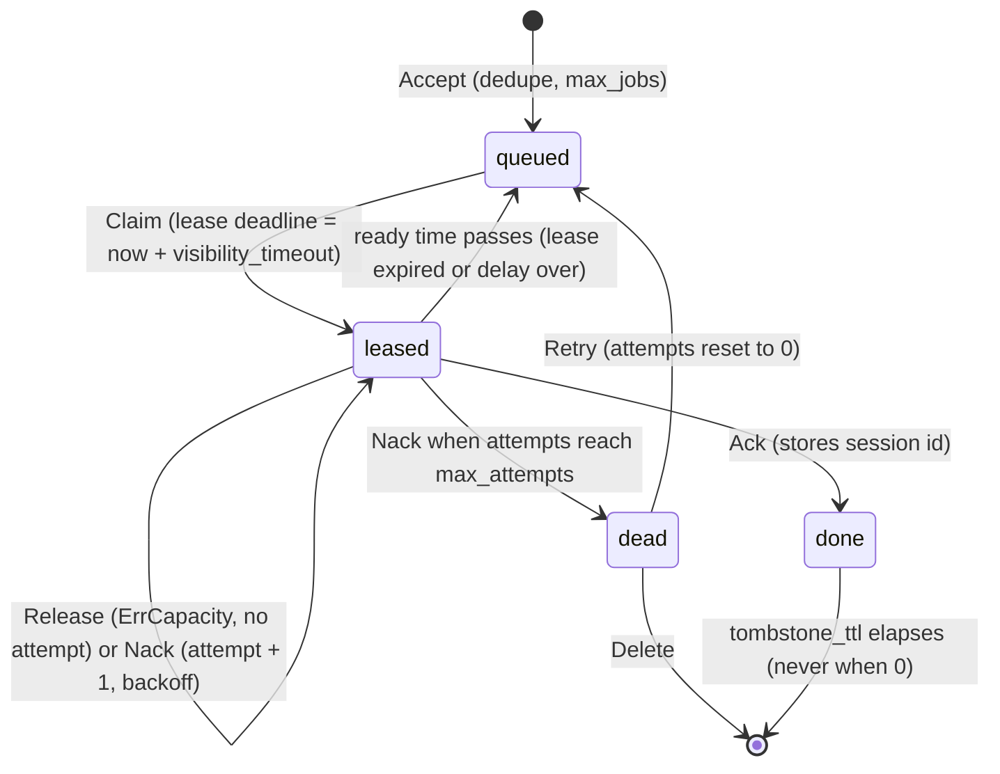

# Architecture

This document describes the high-level architecture of mayfly. If you want to find your way around the code, start here. For request sequences, the artifact format, and the failure table, see [docs/architecture.md](docs/architecture.md).

## Bird's-eye view

Mayfly turns events into short-lived agent sessions. A session has one prompt, one container (or local process), a shared chat thread that people can attach to, a time limit, and an artifact bundle when it ends. Nothing runs between sessions.

The system has four layers, all in one control-plane process, `mayflyd`:

1. **Trigger.** `POST /hooks/{name}` verifies a GitHub, Slack, Datadog, or generic webhook, spends one rate-limit token, and stores a job. The sender gets `202` (or Slack's in-channel reply) as soon as the job is committed. No pod exists yet. `POST /api/v1/sessions` (API, CLI, web UI) skips this layer and creates a session synchronously.
2. **Queue.** `queue.Store` holds jobs durably (`memory`, `bbolt`, or any Redis-protocol server). `queue.Worker` leases jobs only when the session cap has room, and dispatches each job to its handler: `session.Manager.Create` for a webhook, or the workflow runner for a scheduled source run.
3. **Schedule.** `internal/workflow` compiles each scheduled source plan at startup. A timer enqueues one `source` job per cron slot, and the worker runs the plan, writes a run artifact, and creates a session only when the change totals match `triggerOn`.
4. **Session.** `session.Manager` resolves the agent, model, skills, and MCP servers, then starts the runtime through a `runner.Runner` (one Kubernetes pod with its own Secret, ConfigMap, and NetworkPolicy, or a child process). It tracks the session until a terminal state, stores the artifact bundle, and deletes the resources.

Inside the container, `mayfly-harness` reads `session.json` and execs either a named harness from `/opt/mayfly/harnesses` or the built-in `mayfly-agent`. The runtime only makes outbound calls to `/internal/v1/...` with a per-session token. It streams events, reads its inbox, calls the LLM and HTTP MCP servers through the control plane's credential broker, then uploads a bundle and reports finalize.

A turn is executed as ordered journaled steps. The journal lives in the control plane (bbolt by default) and records each completed `user`, `llm`, `tool:<name>`, and `assistant` step with the conversation length it produced. A replacement container resumes the interrupted turn: it truncates `conversation.jsonl` to the last recorded length, replays the turn's event from the journal, applies recorded steps, and executes only the missing ones.

## Code map

### `cmd/`

- `cmd/mayflyd`: wires everything together. It loads config and the project bundle, builds the artifact store, queue store, runner, `hub.Hub`, `session.Manager`, and workflow runner, the tool gateway, and, for service plugins, the reconciler or local service children. It starts the scheduler, `queue.Worker`, and the HTTP server, and on SIGTERM drains the worker before shutting down the manager. `-check` prints the resolved bundle and exits.
- `cmd/mayfly-harness`: image entrypoint. It is a thin wrapper over `internal/harness`. A failure is written to `/dev/termination-log` so the control plane can report it.
- `cmd/mayfly-agent`: the built-in session runtime, a thin wrapper over `internal/agent`.
- `cmd/mayfly-plugin-shim`: `install-self` and `copy` stage plugin trees into a pod; `serve` supervises a stdio plugin and serves streamable HTTP MCP on a Unix socket or TCP; `probe` is the startup and readiness probe.
- `cmd/mayfly`: CLI (`run`, `ls`, `get`, `events`, `attach`, `send`, `close`, `delete`, `artifact`, `agents`). It only talks to the public API. `plugin init|check|test` works offline against `local.command`.
- `cmd/llmstub`, `cmd/mcpstub`: deterministic stub servers for k3d and local runs.

### Control plane

- `internal/httpapi`: all HTTP routes, registered in `server.go`.
  - `webhook.go`: the trigger-to-queue path (`receiveWebhook`).
  - `api.go`: the public session API.
  - `queueadmin.go`: job lookup and dead-letter retry and delete.
  - `internal.go`: the runtime-facing endpoints, including the turn journal, the tool grant, and the tool call routes.
  - `ws.go`: WebSocket attach.
  - `web/`: the embedded UI.
  - Errors from the packages below are mapped to HTTP status codes here and nowhere else.
- `internal/plugin`: the `plugin.yaml` types, `Parse`, `Load`, and `Validate` with defaults, plus `ToolName`, `IsManifestPath`, `ContainerName`, and `ObjectName`. It imports neither Kubernetes nor the MCP client, so the loader, the CLI, and the reconciler share it.
- `internal/gateway`: the tool choke point. `GrantFor` builds a session's tool table from `session.json` and `mcp.servers`; `Begin` and `Complete` implement the ledger resume table; `limits.go` holds the per-session plugin rate limiters and the in-flight cap; `token.go` signs and verifies call tokens; `audit.go` writes the call records; `remote.go` holds one upstream MCP client per session and server and calls service and HTTP `mcp.servers` tools.
- `internal/triggers`: `Parse` verifies a webhook (HMAC or token per type, or `allow_unsigned`) and returns a `Result` with `session.CreateOptions`, an optional Slack URL-verification `Challenge`, and a `DeliveryKey`. The key is `X-GitHub-Delivery`, Slack `trigger_id`, or the `Idempotency-Key` header. Prompts are rendered from the trigger's `template` with `triggers.Data`.
- `internal/ratelimit`: the token bucket behind per-trigger `rate_limit`. A nil `*Limiter` allows everything.
- `internal/queue`: the durable intake.
  - `queue.go`: `Job`, `Lease`, `Record`, `State`, the `Store` interface, `NewJob`, and `Backoff`.
  - Backends: `memory.go`, `bbolt.go` (buckets `jobs`, `ready`, `seen`, `dead`, `done`, plus expiry indexes) and `redis.go` (Lua scripts for accept, claim, and settle, with keys hash-tagged by `key_prefix`).
  - `worker.go`: `Worker`, the claim loop.
  - `handler.go`: `SessionHandler`, which maps `session.ErrCapacity` to `ErrRetryLater`, and `Composite`, which routes a job by `Kind`.
- `internal/project`: bundle loader. It reads `.yaml`, `.yml`, and `.json` files from `agents.dirs`, applies scopes and the RFC 7386 `extends` merge, rejects duplicate names, and compiles every schedule into a `sources.Plan`. A bad bundle stops startup.
- `internal/sources`: the declarative source engine. `Build` constructs one `http.json` source; `Plan.Run` executes the dependency order. `jsonpath.go` projects documents, `filter.go` keeps matching items, and `httpjson.go` owns requests, pagination, fanout, retry, change tracking, and diff truncation. There is no provider-specific code.
- `internal/state`: the schedule watermark store. `LastSlot` and `SetLastSlot` are backed by bbolt at `sources.state_path`, or by memory in tests.
- `internal/workflow`: the scheduler and the source job handler. `workflow.go` runs a plan, writes `runs/<schedule>/<run>.json`, gates on `triggerOn`, builds the prompt with the untrusted notice, and creates the session. `scheduler.go` accepts each UTC cron slot once and catches up the most recent missed slot, up to seven days.
- `internal/pluginsvc`: service plugin workloads. `reconcile.go` renders and reconciles one Deployment, Service, NetworkPolicy, and gateway key Secret per service plugin; `local.go` runs one shim child per service plugin on the local backend and answers the gateway's endpoint question for both.
- `internal/session`: `Manager` is the session registry and lifecycle engine.
  - `manager.go`: `Create`, `Validate`, the capacity check (`reserveLocked`, `FreeSlots`), token handling, plugin resolution (`resolvePlugins`), and the sidecar gateway key.
  - `lifecycle.go`: thread access, artifact upload, `Close`, `Complete`, `finalize`, `cleanup`, the fallback export, adoption of running pods after a restart, and the maintenance loop (`reap` every 5 s, `pollPods` on `runtime.poll_interval`). Finalize drops the session's tool grant.
  - `restart.go`: replacement containers. A non-terminal pod failure starts a new pod with the same session, Secret, ConfigMap, NetworkPolicy, workspace claim, and runtime config, up to `sessions.max_restarts`. The local backend re-resolves plugin secrets before it starts the replacement. The runtime always checks the journal on startup, so the mounted config needs no update, and the journaled thread is restored after a control-plane restart.
  - `agents.go`: agent resolution, prompt data, and the startup checks for plugin selection.
- `internal/hub`: the in-memory thread bus. There is one stream per session with a monotonic `Seq`, a bounded backlog (`sessions.event_buffer`), and fan-out to subscribers, with a separate inbox view for the runtime. An event may carry a `step_key`; the hub drops a repeated key so re-running a step does not duplicate its thread message.
- `internal/journal`: the turn step journal. `Entry` is one completed step; `Store` is implemented by an in-memory store for tests and by bbolt for the control plane. `Durable` adds the per-session sequence reservation, which keeps a restarted hub from handing out a turn key that the journal already uses, and session deletion. Journal payloads also carry the thread events a step produced, so recovery can rebuild the thread without executing the step. `Ledger` and `Call` are the tool delivery records: both stores also implement `Begin`, `Complete`, and `Get` for a key of `<session>/<turn>/<step>`, and `Delete` removes a session's calls with its steps.
- `internal/runner`: the `Runner` interface (`Start`, `Stop`, `Logs`) and the `Spec` and `Handle` types. `kubernetes.go` delegates to `internal/k8s` and can reuse session resources for a replacement pod. `local.go` runs `mayfly-agent` as a child process with a per-session state directory, writes inline plugin secret files before it starts, and provides no isolation; that directory survives a child restart.
- `internal/k8s`: `spec.go` builds the Pod, Secret, ConfigMap, NetworkPolicy, and workspace claim for a `SessionSpec`, with the hardened security context and the `mayfly.io/managed` and `mayfly.io/session` labels. It also adds the `mayfly-tools`, `plugin-<name>` copy init containers, the inline plugins volume, the `plugin-sockets` volume, the native sidecar containers, and the secret projections. One PVC (`mayfly-<id>-workspace`) is mounted at `/workspace` and `/artifacts` through subPaths when `sessions.persistent_workspace` is on. `client.go` creates, lists, and deletes these objects, garbage-collects labelled objects whose pod is gone, and reads the config and token back for adoption.
- `internal/broker`: the credential proxy for `/internal/v1/llm/chat/completions` and `/internal/v1/mcp/{server}`. It rewrites the request to the session's model and injects upstream credentials. `HTTPClient` hands the gateway its client with the same dial, TLS, and response-header timeouts.
- `internal/artifact`: the `Store` interface (`Put`, `Get`), with `localStore` and an S3-compatible store in `s3.go`. `Key` names a bundle.
- `internal/agents`: loads agent manifests (YAML or JSON) from `agents.dirs` into `Agent` values with a prompt template.
- `internal/skills`: loads Markdown skills from directories and from pinned tar.gz sources that are checked against a SHA-256.
- `internal/config`: the `Config` tree, `Load`, defaults, validation, and `env:` secret resolution. `repo.go` turns a repo reference into an archive URL.

### Shared types

- `internal/model`: public types shared by the control plane, runtime, and clients: `Session`, `SessionStatus`, `Event`, `EventType`, `TriggerInfo`, and `ArtifactInfo`.
- `internal/sessioncfg`: the `session.json` document (`Config`) passed from control plane to runtime, its `Validate`, and the reserved env vars `MAYFLY_CONFIG` and `MAYFLY_SESSION_TOKEN`.
- `internal/bundle`: the tar.gz bundle writer. `manifest.json` is written last. The runtime and the control-plane fallback export both use it.
- `internal/version`: build metadata set by ldflags.

### Session runtime

- `internal/harness`: `Resolve` picks the harness executable. An unknown or non-executable harness is an error and never falls back.
- `internal/agent`: `Runtime`, the built-in agent loop.
  - `runtime.go`: `Run`, which covers the inbox, turn worker, and idle and TTL timers, `handleTurn` as an ordered compute/apply step machine, model retries across control-plane replacement, the plugin host lifecycle, gateway discovery, and resume setup.
  - `steps.go`: journal payloads and the `runOrReplay` helper that applies recorded output or executes a missing step. `toolStepOutput` carries `Replayed` and `Interrupted`.
  - `conversation.go`: the JSONL conversation, including reload from disk, `Size`, and `Truncate` for resume.
  - `tools.go`: built-in, MCP, and plugin tools. A granted tool goes through `callGranted`, which begins and completes a gateway call; the built-ins stay local.
  - `events.go`, `trace.go`: the JSONL logs and step-keyed thread events.
  - `finalize.go`: bundle, upload, and finalize, run once. Inline plugin stderr logs are added to the bundle.
- `internal/pluginhost`: inline and sidecar plugin members. `host.go` starts an inline plugin with an exact environment, verifies its `tools/list`, restarts it within the manifest budget, and calls a tool with `_meta`; `sidecar.go` connects to the shim over a Unix socket with discovery and call tokens; `env.go` builds the environment; `stderr.go` caps the stderr file.
- `internal/platformclient`: the runtime's HTTP client for events, the SSE inbox, artifact upload, finalize, the turn journal, and the tool gateway (`Tools`, `BeginCall`, `CompleteCall`). Journal and gateway requests retry so a control-plane replacement delays a step rather than losing it.
- `internal/llm`: the OpenAI-compatible chat completions client.
- `internal/mcp`: MCP clients. `stdio.go` runs servers inside the container and supports an exact environment, `_meta`, cancellation, and an exit channel. `http.go` reaches servers through the broker, with an optional custom client and a Unix-socket dialer for the shim. `manager.go` starts them all and applies the `tools` allowlist.
- `internal/stub`: the LLM and MCP stubs used by tests and k3d. They are not on the production path.

### Everything else

- `deploy/helm/mayfly`, `deploy/k8s`: Helm chart (optional LiteLLM) and kustomize base with a local overlay.
- `deploy/terraform/civo`: Terraform for a one-node Civo cluster with Cilium, sized for Mayfly and the e2e suite.
- `hack/`: `run-local.sh`, `k3d-up.sh`, `e2e.sh`.
- `e2e/`: the end-to-end suite (build tag `e2e`), its Helm values, and fixtures. See `docs/testing.md`.
- `test/integration`: an in-process end-to-end test, `TestWebhookToArtifact`.
- `docs/`: user-facing docs. `docs/architecture.md` has the sequence diagrams.

## Job lifecycle

`queue.State` is what `Store.Get` reports. `leased` covers both a worker holding the job and a job waiting out a retry or release delay.

Sessions use the `model.SessionStatus` values `pending`, `running`, `closing`, `completed`, `expired`, and `failed`. They are described in [docs/architecture.md](docs/architecture.md#state-model).

## Invariants

Queue:

- A webhook is answered only after `Store.Accept` commits, and nothing on the request path talks to Kubernetes. `Manager.Validate` runs before accept so the sender hears about a bad request, and `Create` checks it again when the job runs.
- A rate-limit token is spent only after `triggers.Parse` verifies the request.
- A job with a delivery key has ID `d-` + the first 16 bytes of `sha256(trigger + "\x00" + delivery)` in hex. Dedupe is therefore per trigger. The dedupe key lives for `dedupe_ttl` (default 72h) regardless of what happens to the job afterwards. A job without a key gets a random ID and is never deduplicated.
- `max_jobs` (default 1000) counts queued and leased jobs only. Done and dead jobs do not count.
- Delivery is at least once. A lease is identified by its deadline. In bbolt that is the `ready` key, in Redis the sorted-set score, and in memory `readyAt`. `Nack` and `Release` succeed only while that deadline is still current, and otherwise return `ErrLeaseLost`. `Ack` does not check the lease. If a worker creates a session and then dies before `Ack`, the job runs again after `visibility_timeout` (default 5m, minimum 2m). While a handler runs, the worker renews its lease every third of `visibility_timeout`, so the timeout detects a crashed worker instead of bounding job length. Each job kind has its own deadline: `sources.job_timeout` for schedule jobs, 5 minutes for other kinds.
- The worker never claims more than `min(concurrency, FreeSlots()) - inflight`. Hitting the session cap is not a failure: `ErrCapacity` becomes `ErrRetryLater`, and the job is released after `5 x poll_interval` without spending an attempt.
- Failure backoff is `retry_base << (attempts-1)`, capped at 10 minutes. At `max_attempts` (default 5) the job is buried with its last error. Only `Retry` (attempts reset to 0) or `Delete` removes it from the dead set.
- `Ack` keeps a done record (job plus session ID) for `tombstone_ttl` (default 1h). The session also stores the job ID in `trigger.job_id`, so either side can be found from the other. bbolt purges expired records lazily on `Accept`, at most 256 per call.
- On shutdown the worker releases leases it claimed but never started. Handlers already running finish on a context detached from shutdown.

Schedule:

- A bundle with an unknown connection, an invisible source, a duplicate name, a dependency cycle, or a bad cron fails startup and names the item. There is no runtime fallback for a bad bundle.
- Every slot is a UTC minute. The delivery key is `schedule:<name>:<RFC3339 slot>`, so the same slot cannot be accepted twice, and the watermark is written only after `Accept` succeeds.
- The first start records the current slot and starts nothing. A later start catches up only the most recent missed slot, and only within seven days.
- Every accepted run writes `runs/<schedule>/<run>.json` before any session exists. An artifact over `sources.max_artifact_bytes` fails the job, which is retried by the queue. A retried job reads its stored artifact instead of calling the providers again, because change tracking reports a change only once. The session is created with the job ID as its idempotency key, so a retry never starts a second session for one run.
- A session starts only when the totals match `triggerOn`. `new` is a baseline and does not trigger unless listed.
- The prompt is built from the run: 8 KiB per diff, 32 KiB for the whole change section, and a fixed untrusted-content notice that a schedule cannot remove. The artifact keeps every document, with each diff already cut to the source's `maxLines` and `maxLineChars`; the provider's full diff is not stored.

Session:

- `reserveLocked` is the only place the `sessions.max_concurrent` cap is enforced. `FreeSlots` is advisory.
- A session becomes `running` only when its runtime opens the inbox (`RuntimeConnected`), not when the container starts. A runtime that does not connect within `sessions.connect_timeout` is failed by the fallback path.
- `finalize` runs at most once per session (`instance.finalized`), and `cleanup` deletes resources at most once (`resourcesDeleted`). Cleanup runs through `dispatch`, so `Shutdown` waits for it, and it deletes the ConfigMap before the pod. A finalize reporting `completed` becomes `expired` when the close reason was TTL or expiry.
- Every session that reaches a terminal state has had an artifact attempted. Either the runtime uploads a bundle (size and SHA-256 are checked before `Put`), or `fallback` exports a partial bundle with logs, retained events, and `session.json`.
- The runtime receives only `user_message` and `control` events (`Event.IsInbox`), so it never re-reads its own output.
- A turn is keyed by the inbox event `Seq` that started it. Steps are numbered from zero in a fixed order: `user`, then each `llm` or terminal `assistant` response, with one `tool:<name>` step per tool call in order. An entry is appended before its conversation line is applied, and `ConvLen` is the post-apply size.
- A runtime always reads the journal on startup, takes the most recently written turn, truncates `conversation.jsonl` down to the last entry's `ConvLen`, and rebuilds the turn event from step zero's recorded input. It applies recorded steps and executes only steps the journal does not hold. A completed tool call is therefore never repeated. A granted call that was in flight when the container died is answered by the ledger: an idempotent tool is dispatched again with the same key, and a non-idempotent one returns the interrupted error result. A built-in tool such as `run_command` is outside the ledger and can run again.
- A replacement container starts for a non-terminal `pending` or `running` session whose pod fails or disappears, up to `sessions.max_restarts` (default 2). It reuses the session token, Secret, ConfigMap, NetworkPolicy, workspace claim, and runtime config. The fallback export runs only after the last replacement attempt fails. `sessions.persistent_workspace` (default true) keeps the workspace and `conversation.jsonl` across replacements; when it is false no replacement is started, because the turn could not resume.
- The token index stores only a hash and removes it on finalize. The manager also keeps the plaintext in memory for the session lifetime so the local backend can start a replacement process; Kubernetes replacements reuse the Secret.

Tool calls:

- The runtime never runs a granted tool without a successful gateway begin. If the gateway stays unreachable past the five-minute budget, it exits without finalizing so a replacement resumes.
- A call key is `<session>/<turn>/<step>`. The gateway hashes the canonical arguments and never stores them. The same key with another tool or another hash is `409`.
- A `done` record is returned with `replayed` and the tool is not called. A `pending` non-idempotent record becomes one error result with `interrupted`, and the record is completed with that result. A `pending` idempotent record is dispatched again with the same key.
- Inline, sidecar, and stdio calls run in the runtime after the begin and are completed with the result. Service and HTTP `mcp.servers` calls run inside the gateway. Either way the ledger record is written before the journal step that references it.
- The ledger lives in the journal store and `Delete` removes it with the session's steps. Audit records carry the key, tool, owner, placement, argument hash, duration, and outcome, never the arguments or the result.

Process:

- One `mayflyd` replica owns every session. Session records and thread buffers live only in memory. After a restart, Kubernetes pods labeled `mayfly.io/managed=true` are adopted from their ConfigMap and Secret. The last journaled turn is replayed into the new thread from the journal; earlier turns are lost from the live thread, though the runtime's `conversation.jsonl` still contains them for the final bundle. The local backend's sessions are not adopted.
- The journal (`journal.backend`, `bbolt` by default) is the only cross-restart record of an in-flight turn. It must live on the control plane's PersistentVolume alongside the queue database.
- Running several replicas is still not supported in 0.1: the session registry, thread buffers, token index, and artifact index are process memory.

## Cross-cutting concerns

**Configuration.** `config.Load` decodes YAML with unknown fields rejected, applies defaults, then validates. Secrets are referenced by env var name (`*_env` fields such as `token_env`, `secret_env`, `api_key_env`, `password_env`, or `env:NAME` header values) and resolved in the control plane only. `sessioncfg.Config` is the only configuration a runtime sees.

**Storage.** There are three separate stores with separate lifetimes:

- The queue store (`queue.backend`). `memory` loses jobs on restart. `bbolt` and `redis` survive it.
- The journal store (`journal.backend`). `memory` is for tests; `bbolt` survives a control-plane restart. It holds the completed steps of every turn of an active session so a replacement runtime can resume, and deletes them when the session finalizes. It also holds each session's reserved sequence floor.
- The schedule state store (`sources.state_path`), a bbolt file with one watermark per schedule. It must sit on the same PersistentVolume as the queue and journal. Without it a restart forgets the watermark and the catch-up window restarts.
- The artifact store (`artifacts.store`), either local or S3-compatible. This is the durable history of a completed session and of every schedule run (`runs/`).
- In-memory session state in `session.Manager` and `hub.Hub`. Finalized sessions are dropped after `sessions.retention`, but the artifact index outlives them so downloads keep working.

**Errors.** Packages return sentinel errors and wrap with `%w`: `queue.ErrDuplicate`, `ErrFull`, `ErrRetryLater`, `ErrLeaseLost`, and `ErrNotFound`; `session.ErrCapacity`, `ErrNotFound`, `ErrClosed`, and `ErrUnauthorized`; `triggers.ErrUnauthorized` and `ErrBadRequest`. `internal/httpapi` maps them to status codes with `errors.Is`. Background loops log with `slog` and keep going rather than returning errors.

**Testing.** `make test` runs `go test ./...`.

- `internal/queue/store_test.go` runs every store test against memory, bbolt, and Redis. Redis uses in-process miniredis, or the server named by `MAYFLY_REDIS_TEST_URL`.
- `worker_test.go` covers capacity, release, and shutdown.
- `test/integration` drives a webhook through the queue, a real `mayfly-agent` process on the local runner, a WebSocket attach, close, and artifact inspection, all against the stubs. `TestLocalResumeAfterKill` kills the agent with SIGKILL after its first tool call, lets the manager start a replacement, and checks that the turn completes, the journal has one entry per step, and the completed tool ran once.
- `e2e/` (`make e2e`) runs the chart and images on k3d, where k3s's built-in controller enforces NetworkPolicy, and checks webhooks, queue durability across a control plane restart, dead letters, network isolation, and the session lifecycle. `TestSessionResumesAfterPodDeletion` deletes a running pod mid-turn and `TestControlPlaneRestartContinuesTurn` replaces `mayflyd` mid-turn; both check the replacement, the single user message, and one completed tool call.

**Observability.** JSON `slog` goes to stderr, with the level set by `MAYFLY_LOG_LEVEL`. `GET /api/v1/queue` reports queue depth, and `GET /readyz` checks only that the lifecycle engine is running, not the artifact store.
