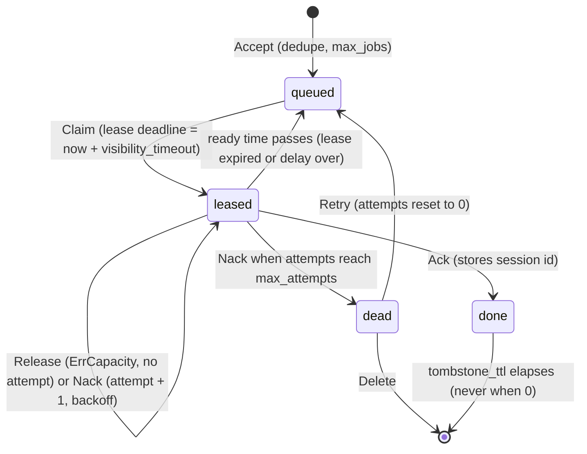

# Architecture

This document describes the high-level architecture of mayfly. If you want to find your way around the code, start here. For request sequences, the artifact format, and the failure table, see [docs/architecture.md](docs/architecture.md).

## Bird's-eye view

Mayfly turns events into short-lived agent sessions. A session has one prompt, one container (or local process), a shared chat thread that people can attach to, a time limit, and an artifact bundle when it ends. Nothing runs between sessions.

The system has three layers, all in one control-plane process, `mayflyd`:

1. **Trigger.** `POST /hooks/{name}` verifies a GitHub, Slack, Datadog, or generic webhook, spends one rate-limit token, and stores a job. The sender gets `202` (or Slack's in-channel reply) as soon as the job is committed. No pod exists yet. `POST /api/v1/sessions` (API, CLI, web UI) skips this layer and creates a session synchronously.
2. **Queue.** `queue.Store` holds jobs durably (`memory`, `bbolt`, or any Redis-protocol server). `queue.Worker` leases jobs only when the session cap has room, and calls `session.Manager.Create` for each one.
3. **Session.** `session.Manager` resolves the agent, model, skills, and MCP servers, then starts the runtime through a `runner.Runner` (one Kubernetes pod with its own Secret, ConfigMap, and NetworkPolicy, or a child process). It tracks the session until a terminal state, stores the artifact bundle, and deletes the resources.

Inside the container, `mayfly-harness` reads `session.json` and execs either a named harness from `/opt/mayfly/harnesses` or the built-in `mayfly-agent`. The runtime only makes outbound calls to `/internal/v1/...` with a per-session token. It streams events, reads its inbox, calls the LLM and HTTP MCP servers through the control plane's credential broker, then uploads a bundle and reports finalize.

## Code map

### `cmd/`

- `cmd/mayflyd`: wires everything together. It loads config, builds the artifact store, queue store, runner, `hub.Hub`, and `session.Manager`, starts `queue.Worker` and the HTTP server, and on SIGTERM drains the worker before shutting down the manager.
- `cmd/mayfly-harness`: image entrypoint. It is a thin wrapper over `internal/harness`. A failure is written to `/dev/termination-log` so the control plane can report it.
- `cmd/mayfly-agent`: the built-in session runtime, a thin wrapper over `internal/agent`.
- `cmd/mayfly`: CLI (`run`, `ls`, `get`, `events`, `attach`, `send`, `close`, `delete`, `artifact`, `agents`). It only talks to the public API.
- `cmd/llmstub`, `cmd/mcpstub`: deterministic stub servers for kind and local runs.

### Control plane

- `internal/httpapi`: all HTTP routes, registered in `server.go`.
  - `webhook.go`: the trigger-to-queue path (`receiveWebhook`).
  - `api.go`: the public session API.
  - `queueadmin.go`: job lookup and dead-letter retry and delete.
  - `internal.go`: the runtime-facing endpoints.
  - `ws.go`: WebSocket attach.
  - `web/`: the embedded UI.
  - Errors from the packages below are mapped to HTTP status codes here and nowhere else.
- `internal/triggers`: `Parse` verifies a webhook (HMAC or token per type, or `allow_unsigned`) and returns a `Result` with `session.CreateOptions`, an optional Slack URL-verification `Challenge`, and a `DeliveryKey`. The key is `X-GitHub-Delivery`, Slack `trigger_id`, or the `Idempotency-Key` header. Prompts are rendered from the trigger's `template` with `triggers.Data`.
- `internal/ratelimit`: the token bucket behind per-trigger `rate_limit`. A nil `*Limiter` allows everything.
- `internal/queue`: the durable intake.
  - `queue.go`: `Job`, `Lease`, `Record`, `State`, the `Store` interface, `NewJob`, and `Backoff`.
  - Backends: `memory.go`, `bbolt.go` (buckets `jobs`, `ready`, `seen`, `dead`, `done`, plus expiry indexes) and `redis.go` (Lua scripts for accept, claim, and settle, with keys hash-tagged by `key_prefix`).
  - `worker.go`: `Worker`, the claim loop.
  - `handler.go`: `SessionHandler`, which maps `session.ErrCapacity` to `ErrRetryLater`.
- `internal/session`: `Manager` is the session registry and lifecycle engine.
  - `manager.go`: `Create`, `Validate`, the capacity check (`reserveLocked`, `FreeSlots`), and token handling.
  - `lifecycle.go`: thread access, artifact upload, `Close`, `Complete`, `finalize`, `cleanup`, the fallback export, adoption of running pods after a restart, and the maintenance loop (`reap` every 5 s, `pollPods` on `runtime.poll_interval`).
  - `agents.go`: agent resolution and prompt data.
- `internal/hub`: the in-memory thread bus. There is one stream per session with a monotonic `Seq`, a bounded backlog (`sessions.event_buffer`), and fan-out to subscribers, with a separate inbox view for the runtime.
- `internal/runner`: the `Runner` interface (`Start`, `Stop`, `Logs`) and the `Spec` and `Handle` types. `kubernetes.go` delegates to `internal/k8s`. `local.go` runs `mayfly-agent` as a child process with a per-session state directory and provides no isolation.
- `internal/k8s`: `spec.go` builds the Pod, Secret, ConfigMap, and NetworkPolicy for a `SessionSpec`, with the hardened security context and the `mayfly.io/managed` and `mayfly.io/session` labels. `client.go` creates, lists, and deletes these objects and reads the config and token back for adoption.
- `internal/broker`: the credential proxy for `/internal/v1/llm/chat/completions` and `/internal/v1/mcp/{server}`. It rewrites the request to the session's model and injects upstream credentials.
- `internal/artifact`: the `Store` interface (`Put`, `Get`), with `localStore` and an S3-compatible store in `s3.go`. `Key` names a bundle.
- `internal/agents`: loads agent manifests (YAML or JSON) from `agents.dirs` into `Agent` values with a prompt template.
- `internal/skills`: loads Markdown skills from directories and from pinned tar.gz sources that are checked against a SHA-256.
- `internal/config`: the `Config` tree, `Load`, defaults, validation, and `env:` secret resolution. `repo.go` turns a repo reference into an archive URL.

### Shared types

- `internal/model`: public types shared by the control plane, runtime, and clients: `Session`, `SessionStatus`, `Event`, `EventType`, `TriggerInfo`, and `ArtifactInfo`.
- `internal/sessioncfg`: the `session.json` document (`Config`) passed from control plane to runtime, its `Validate`, and the reserved env vars `MAYFLY_CONFIG` and `MAYFLY_SESSION_TOKEN`.
- `internal/bundle`: the tar.gz bundle writer. `manifest.json` is written last. The runtime and the control-plane fallback export both use it.
- `internal/version`: build metadata set by ldflags.

### Session runtime

- `internal/harness`: `Resolve` picks the harness executable. An unknown or non-executable harness is an error and never falls back.
- `internal/agent`: `Runtime`, the built-in agent loop.
  - `runtime.go`: `Run`, which covers the inbox, turn worker, and idle and TTL timers, and `handleTurn`.
  - `tools.go`: built-in and MCP tools.
  - `conversation.go`, `trace.go`, `events.go`: the JSONL logs.
  - `finalize.go`: bundle, upload, and finalize, run once.
- `internal/platformclient`: the runtime's HTTP client for events, the SSE inbox, artifact upload, and finalize.
- `internal/llm`: the OpenAI-compatible chat completions client.
- `internal/mcp`: MCP clients. `stdio.go` runs servers inside the container. `http.go` reaches servers through the broker. `manager.go` starts them all.
- `internal/stub`: the LLM and MCP stubs used by tests and kind. They are not on the production path.

### Everything else

- `deploy/helm/mayfly`, `deploy/k8s`: Helm chart (optional LiteLLM) and kustomize base with a kind overlay.
- `deploy/terraform/civo`: Terraform for a one-node Civo cluster with Cilium, sized for Mayfly and the e2e suite.
- `hack/`: `run-local.sh`, `kind-up.sh`, `e2e.sh`.
- `e2e/`: the end-to-end suite (build tag `e2e`), its Helm values, and fixtures. See `docs/testing.md`.
- `test/integration`: an in-process end-to-end test, `TestWebhookToArtifact`.
- `docs/`: user-facing docs. `docs/architecture.md` has the sequence diagrams.

## Job lifecycle

`queue.State` is what `Store.Get` reports. `leased` covers both a worker holding the job and a job waiting out a retry or release delay.

Sessions use the `model.SessionStatus` values `pending`, `running`, `closing`, `completed`, `expired`, and `failed`. They are described in [docs/architecture.md](docs/architecture.md#state-model).

## Invariants

Queue:

- A webhook is answered only after `Store.Accept` commits, and nothing on the request path talks to Kubernetes. `Manager.Validate` runs before accept so the sender hears about a bad request, and `Create` checks it again when the job runs.
- A rate-limit token is spent only after `triggers.Parse` verifies the request.
- A job with a delivery key has ID `d-` + the first 16 bytes of `sha256(trigger + "\x00" + delivery)` in hex. Dedupe is therefore per trigger. The dedupe key lives for `dedupe_ttl` (default 72h) regardless of what happens to the job afterwards. A job without a key gets a random ID and is never deduplicated.
- `max_jobs` (default 1000) counts queued and leased jobs only. Done and dead jobs do not count.
- Delivery is at least once. A lease is identified by its deadline. In bbolt that is the `ready` key, in Redis the sorted-set score, and in memory `readyAt`. `Nack` and `Release` succeed only while that deadline is still current, and otherwise return `ErrLeaseLost`. `Ack` does not check the lease. If a worker creates a session and then dies before `Ack`, the job runs again after `visibility_timeout` (default 5m, minimum 2m). There is no lease renewal, so a handler must finish within the visibility timeout. `Worker` caps each handler at 5 minutes.
- The worker never claims more than `min(concurrency, FreeSlots()) - inflight`. Hitting the session cap is not a failure: `ErrCapacity` becomes `ErrRetryLater`, and the job is released after `5 x poll_interval` without spending an attempt.
- Failure backoff is `retry_base << (attempts-1)`, capped at 10 minutes. At `max_attempts` (default 5) the job is buried with its last error. Only `Retry` (attempts reset to 0) or `Delete` removes it from the dead set.
- `Ack` keeps a done record (job plus session ID) for `tombstone_ttl` (default 1h). The session also stores the job ID in `trigger.job_id`, so either side can be found from the other. bbolt purges expired records lazily on `Accept`, at most 256 per call.
- On shutdown the worker releases leases it claimed but never started. Handlers already running finish on a context detached from shutdown.

Session:

- `reserveLocked` is the only place the `sessions.max_concurrent` cap is enforced. `FreeSlots` is advisory.
- A session becomes `running` only when its runtime opens the inbox (`RuntimeConnected`), not when the container starts. A runtime that does not connect within `sessions.connect_timeout` is failed by the fallback path.
- `finalize` runs at most once per session (`instance.finalized`), and `cleanup` deletes resources at most once (`resourcesDeleted`). A finalize reporting `completed` becomes `expired` when the close reason was TTL or expiry.
- Every session that reaches a terminal state has had an artifact attempted. Either the runtime uploads a bundle (size and SHA-256 are checked before `Put`), or `fallback` exports a partial bundle with logs, retained events, and `session.json`.
- The runtime receives only `user_message` and `control` events (`Event.IsInbox`), so it never re-reads its own output.
- The session token is stored only as a hash and is removed on finalize. It authorizes that one session's internal endpoints and nothing else. LLM keys, MCP headers, and object-store credentials stay in `mayflyd`.

Process:

- One `mayflyd` replica owns every session. Session records and thread buffers live only in memory. After a restart, Kubernetes pods labeled `mayfly.io/managed=true` are adopted from their ConfigMap and Secret, but the pre-restart thread is lost. The local backend's sessions are not adopted.
- Running several replicas against a shared Redis queue is not supported in 0.1 because there is no lease renewal.

## Cross-cutting concerns

**Configuration.** `config.Load` decodes YAML with unknown fields rejected, applies defaults, then validates. Secrets are referenced by env var name (`*_env` fields such as `token_env`, `secret_env`, `api_key_env`, `password_env`, or `env:NAME` header values) and resolved in the control plane only. `sessioncfg.Config` is the only configuration a runtime sees.

**Storage.** There are three separate stores with separate lifetimes:

- The queue store (`queue.backend`). `memory` loses jobs on restart. `bbolt` and `redis` survive it.
- The artifact store (`artifacts.store`), either local or S3-compatible. This is the only durable session history.
- In-memory session state in `session.Manager` and `hub.Hub`. Finalized sessions are dropped after `sessions.retention`, but the artifact index outlives them so downloads keep working.

**Errors.** Packages return sentinel errors and wrap with `%w`: `queue.ErrDuplicate`, `ErrFull`, `ErrRetryLater`, `ErrLeaseLost`, and `ErrNotFound`; `session.ErrCapacity`, `ErrNotFound`, `ErrClosed`, and `ErrUnauthorized`; `triggers.ErrUnauthorized` and `ErrBadRequest`. `internal/httpapi` maps them to status codes with `errors.Is`. Background loops log with `slog` and keep going rather than returning errors.

**Testing.** `make test` runs `go test ./...`.

- `internal/queue/store_test.go` runs every store test against memory, bbolt, and Redis. Redis uses in-process miniredis, or the server named by `MAYFLY_REDIS_TEST_URL`.
- `worker_test.go` covers capacity, release, and shutdown.
- `test/integration` drives a webhook through the queue, a real `mayfly-agent` process on the local runner, a WebSocket attach, close, and artifact inspection, all against the stubs.
- `e2e/` (`make e2e`) runs the chart and images on kind with Calico and checks webhooks, queue durability across a control plane restart, dead letters, network isolation, and the session lifecycle.

**Observability.** JSON `slog` goes to stderr, with the level set by `MAYFLY_LOG_LEVEL`. `GET /api/v1/queue` reports queue depth, and `GET /readyz` checks only that the lifecycle engine is running, not the artifact store.
