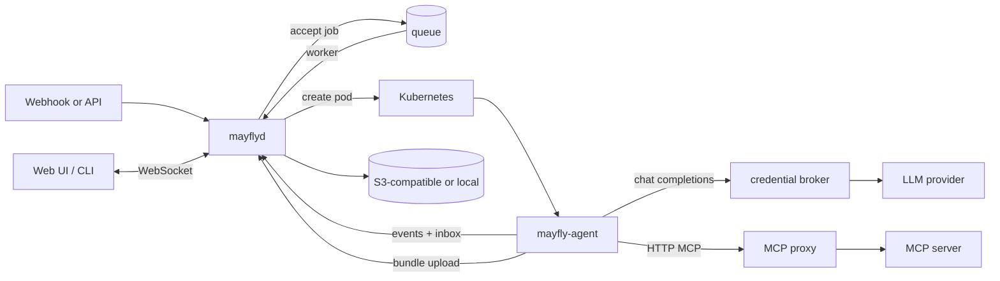

# Mayfly

Mayfly is a self-hosted platform for **ephemeral, interactive agent sessions**. A webhook or API call creates a session, the control plane starts a hardened container, people attach to the live thread, and the session ends with a durable artifact bundle.

Sessions are the unit of work. There is no always-on agent.

## What works

- Webhook triggers: generic HMAC/token, GitHub, Slack slash commands, Datadog.
- Durable webhook intake: verified deliveries are queued (`memory`, `bbolt`, or any Redis-protocol cache) and answered immediately, then a worker creates the session.
- Raw API and CLI creation.
- One Kubernetes pod per session, or a local process backend for development.
- Selectable agent manifests: prompt, model, skills, MCP servers, limits, and an in-image harness name.
- `mayfly-harness` entrypoint selects a named harness or falls back to the built-in loop.
- MCP servers (stdio in the container, HTTP through a credential proxy) and Markdown skills injected at startup, including verified remote skill sources from repo or archive links.
- Shared interactive thread over WebSocket: many people can attach, send messages, and watch tool calls.
- Explicit close, TTL expiry, idle timeout, and crash recovery.
- A session cap (`sessions.max_concurrent`) and per-trigger webhook rate limits, so one noisy trigger cannot overrun the cluster.
- Artifact export on teardown: conversation, events, traces, generated workspace files, and a manifest. Local filesystem or S3-compatible storage.
- Isolation defaults: non-root, read-only root filesystem, all capabilities dropped, no service account token, default-deny ingress, egress only to the control plane and DNS.
- LLM and HTTP MCP credentials stay in the control plane. Sessions receive one scoped token.

## Architecture



The control plane owns lifecycle and the thread. The session runtime owns the agent loop, tools, and bundle assembly. Runtime-to-control-plane traffic goes outbound only, so session pods need no inbound access.

See [docs/architecture.md](docs/architecture.md) for the sequence and state model.

## Install with Helm

Published images are `ghcr.io/hayfever/mayflyd:v0.1.0` and `ghcr.io/hayfever/mayfly-agent:v0.1.0`.

```bash
kubectl create namespace mayfly

kubectl -n mayfly create secret generic mayfly-secrets \
  --from-literal=MAYFLY_API_TOKEN="$(openssl rand -hex 24)" \
  --from-literal=MAYFLY_WEBHOOK_SECRET="$(openssl rand -hex 24)" \
  --from-literal=OPENAI_API_KEY="sk-..."

helm install mayfly oci://ghcr.io/hayfever/charts/mayfly \
  --version 0.1.0 \
  --namespace mayfly \
  --set existingSecret=mayfly-secrets \
  --set config.server.public_url=https://mayfly.example.com
```

For LiteLLM, set `litellm.enabled=true` and provide the provider keys in `litellm-secrets`. See [docs/providers.md](docs/providers.md) and [deploy/helm/mayfly/README.md](deploy/helm/mayfly/README.md).

Local chart install:

```bash
helm install mayfly deploy/helm/mayfly \
  --namespace mayfly \
  --set existingSecret=mayfly-secrets \
  --set config.server.public_url=https://mayfly.example.com
```

## Quickstart with kind

Requirements: Docker, kind, kubectl, Go 1.26+, jq, openssl.

```bash
git clone <repo> mayfly
cd mayfly
make build
./hack/kind-up.sh
```

The script builds images, creates a kind cluster, loads the images, applies manifests, and prints the admin token. The included deployment uses deterministic stub servers for the LLM and one HTTP MCP server, so no API key is needed.

```bash
export MAYFLY_URL=http://localhost:8080
export MAYFLY_TOKEN=<printed token>

./bin/mayfly run --prompt "Investigate the latest deploy failure"
./bin/mayfly ls
./bin/mayfly attach <id>
```

Open <http://localhost:8080> for the web UI and paste the token in Settings.

Close and download:

```bash
./bin/mayfly close <id>
./bin/mayfly artifact <id> -o session.tar.gz
```

Run the automated kind test:

```bash
./hack/e2e-kind.sh
```

## Local development

No Kubernetes and no isolation. Uses the same control plane and runtime code with child processes and local stubs.

```bash
make run-local   # token: dev-token
```

The local example uses port 8080, the same port the kind cluster maps. Stop the kind cluster (or change the local `addr` and URLs) when running both.

In another shell:

```bash
export MAYFLY_URL=http://localhost:8080
export MAYFLY_TOKEN=dev-token
./bin/mayfly run --prompt "Write a report" --ttl 10m
```

`make test` covers unit tests and an in-process end-to-end test with a real session runtime process, WebSocket attach, close, and artifact inspection.

## API

Create a session:

```bash
curl -sS http://localhost:8080/api/v1/sessions \
  -H "Authorization: Bearer $MAYFLY_TOKEN" \
  -H "Content-Type: application/json" \
  -d '{"prompt":"Triage the 5xx spike","ttl":"30m","skills":["incident-triage"]}'
```

Trigger with an unsigned generic webhook (only when configured with `allow_unsigned: true`):

```bash
curl -sS http://localhost:8080/hooks/generic \
  -H 'Content-Type: application/json' \
  -d '{"prompt":"Check the latest deploy"}'
```

Full endpoint list: [docs/api.md](docs/api.md). Provider auth: [docs/providers.md](docs/providers.md). Release process: [docs/release.md](docs/release.md).

## Configuration

See [docs/configuration.md](docs/configuration.md) and the examples:

- [examples/config.local.yaml](examples/config.local.yaml): local processes, stubs, unsigned generic trigger.
- [examples/agents/triage.yaml](examples/agents/triage.yaml): selectable triage agent.
- [examples/config.litellm.yaml](examples/config.litellm.yaml): LiteLLM gateway for OpenAI, Claude, Bedrock, OpenRouter, and internal backends.
- [deploy/k8s/base/configmap.yaml](deploy/k8s/base/configmap.yaml): Kubernetes, OpenAI-compatible LLM, signed generic webhook.

Agents, MCP servers, and skills are selected per session or defaulted globally:

```bash
./bin/mayfly agents
./bin/mayfly run --agent triage --prompt "Triage the checkout outage"
```

An agent is a manifest, not executable plugin code. `harness: pi` selects an executable inside the shared image; empty falls back to the built-in Mayfly loop. See [docs/agents.md](docs/agents.md).

```yaml
mcp:
  servers:
    - name: github
      transport: http
      url: https://mcp.example.com/mcp
      headers:
        Authorization: "env:GITHUB_MCP_TOKEN"   # resolved in the control plane only
skills:
  dirs: [/etc/mayfly-skills]
```

## Status

v0.1.0 is an experimental, single-tenant release. The API and harness protocol may change during 0.x. Read [docs/deployment.md](docs/deployment.md) and the known limitations in [CHANGELOG.md](CHANGELOG.md) before exposing it.

## Security model

Default session pod:

- UID/GID 65532, `runAsNonRoot`, `RuntimeDefault` seccomp.
- `readOnlyRootFilesystem`, no privilege escalation, all capabilities dropped.
- `automountServiceAccountToken: false`, service links disabled.
- EmptyDir workspace, artifact, and tmp volumes with size limits.
- NetworkPolicy: no ingress; egress only to the control plane, cluster DNS, and explicit CIDRs.
- One random session token. It can only write that session's events, upload its artifact, read its inbox, and use the model and MCP servers assigned to the session.
- `run_command` is off unless `sessions.allow_shell` or an agent manifest enables it.
- No LLM key, object-store credential, or MCP credential in the container.

Read [docs/security.md](docs/security.md) before exposing the platform beyond localhost. The short version: this is a single-tenant core, not a multi-tenant SaaS. Use SSO/auth proxy, TLS, per-cluster RBAC, and a CNI that enforces NetworkPolicy.

## Extending

- **Agent:** add a manifest under `agents.dirs`; see [docs/agents.md](docs/agents.md). Use a custom image only for a different harness.
- **Artifact store:** implement `artifact.Store` in [internal/artifact](internal/artifact). Local and S3-compatible are included. GCS native API and Artifact Registry are not implemented.
- **Execution backend:** implement `runner.Runner` in [internal/runner](internal/runner).
- **Trigger:** add a verifier and prompt builder in [internal/triggers](internal/triggers).
- **MCP transport:** add a client in [internal/mcp](internal/mcp).
- **Agent tools:** add built-ins in [internal/agent/tools.go](internal/agent/tools.go).

Keep the credential boundary: new tool backends should be reached through the control plane when they need secrets.

## Non-goals for this version

- Multi-tenant SaaS with per-user isolation.
- Persistent, long-running agent workspaces.
- Replacing commercial SRE agents.
- Workflow DAGs or scheduled agents.
- Native GCS/Artifact Registry artifact backends.

## Project layout

| Path | Purpose |
|---|---|
| `cmd/mayflyd` | control plane |
| `cmd/mayfly-harness` | image entrypoint: selects an in-image harness or Mayfly fallback |
| `cmd/mayfly-agent` | built-in session runtime |
| `cmd/mayfly` | CLI |
| `internal/session` | lifecycle, thread, agent registry, artifact export |
| `internal/agents` | agent manifest loading and prompt templates |
| `internal/httpapi` | API, web UI, webhooks, WebSocket |
| `internal/k8s` | pod, secret, config map, NetworkPolicy |
| `internal/agent` | agent loop, tools, traces, bundle |
| `internal/mcp`, `internal/llm` | protocol clients |
| `internal/broker` | LLM and MCP credential proxy |
| `internal/artifact` | local and S3-compatible stores |
| `deploy/k8s` | base manifests and kind overlay |
| `deploy/helm/mayfly` | Helm chart with optional LiteLLM |
| `hack` | local run, kind deploy, e2e |

## License

Apache-2.0. See [LICENSE](LICENSE).
