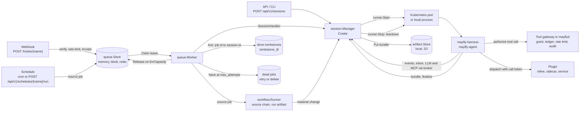

<p align="center"></p>

<p align="center">
  <a href="https://github.com/hayfever/mayfly/actions/workflows/ci.yml"></a>
  <a href="https://github.com/hayfever/mayfly/releases"></a>
  <a href="go.mod"></a>
  <a href="LICENSE"></a>
</p>

Mayfly is a self-hosted control plane for **short-lived, interactive AI agent sessions** on Kubernetes. A webhook, a schedule, the API, the CLI, or the web UI starts a session in a locked-down pod; people can join its live thread, and when it ends you get a durable artifact bundle. The control plane holds every credential: agents reach models, MCP servers, and plugins only through its LLM proxy and audited tool gateway, and nothing runs between sessions.

## Features

### Sessions

- Start a session from a signed webhook (generic HMAC or token, GitHub, Slack slash commands, Datadog), a schedule, the API, the CLI, or the web UI.
- Webhook deliveries are verified, queued, and answered at once; a worker creates the session.
- Scheduled source runs: an `http.json` source chain reads providers (Notion, Firecrawl, any JSON), writes a run artifact, and starts one session on a material change.
- Shared live thread over WebSocket: many people attach, send messages, and watch tool calls.
- Selectable agent manifests: prompt, model, skills, MCP servers, plugins, limits, and an in-image harness.
- Explicit close, TTL expiry, and idle timeout. A session cap and per-trigger rate limits keep one trigger from overrunning the cluster.
- Turn journal: a replacement container resumes an interrupted turn instead of starting over.
- Artifact bundle on teardown: conversation, events, traces, workspace files, and a manifest, in local or S3-compatible storage.

### Security and credentials

- LLM, MCP, and object-store credentials stay in the control plane. A session gets one scoped token and reaches models and HTTP MCP servers through the control plane's proxy.
- Named API tokens with scopes (`server.tokens`), and one audit line per mutating `/api/v1` request.
- Web UI sign-in swaps the token for an `HttpOnly`, `SameSite=Strict` cookie; mutating requests need the CSRF header.
- Hardened session pods on Kubernetes: non-root, read-only root filesystem, all capabilities dropped, no service account token, no ingress, egress only to the control plane and DNS.

### Tools and gateway

- MCP servers: stdio inside the session, HTTP through the control plane.
- Plugins as `inline`, `sidecar`, or `service` workloads, all behind one tool gateway with grants, a call ledger, call tokens, per-plugin rate limits, and an audit log. `mayfly plugin init|check|test` works offline.
- Markdown skills from directories or verified remote archives, cached by SHA-256 (`skills.cache_dir`).

### Operations

- Helm chart with optional LiteLLM, plus a local process backend for development.
- Queue, journal, and session records in `bbolt` or memory; the queue can also use any Redis-protocol server.
- Prometheus metrics and one structured log line per request with a request ID. See [docs/observability.md](docs/observability.md).
- Queue admin API: depth, job status, and dead jobs with retry and delete. Schedules API to list schedules and run one now.
- `mayflyd -check` validates the config and project bundle without starting servers.
- OpenAPI spec with a generated reference in [docs/api-reference.md](docs/api-reference.md); tests fail when routes, scopes, docs, or the spec drift.
- CLI with `--json` on every data command and `mayfly transcript` for a finished session.

### Release and supply chain

- Images for `linux/amd64` and `linux/arm64`, and CLI archives for Linux and macOS.
- Images and chart signed with cosign keyless; images carry SBOM and provenance attestations. See [Verify a release](#verify-a-release).

## Architecture

Mayfly puts a durable job queue in front of a session lifecycle manager. A verified webhook becomes a job, a worker turns each job into a short-lived session (a pod, or a local process in development), and every session ends with teardown and an artifact bundle. The API and CLI skip the queue and create sessions directly.



`mayflyd` owns the trigger, queue, session, and tool gateway layers. The session runtime only makes outbound calls to it, and it never holds an LLM, MCP, or object-store credential. Delivery is at least once: jobs are leased, and a lease that expires makes the job claimable again. Tool calls are recorded in a ledger, so a replacement container replays a completed call instead of repeating it.

See [ARCHITECTURE.md](ARCHITECTURE.md) for the code map and invariants, and [docs/architecture.md](docs/architecture.md) for sequence diagrams, failure handling, non-goals, and the project layout.

## Install with Helm

`1.0.0-rc.1` is the current release. Each tagged release publishes `ghcr.io/hayfever/mayflyd`, `ghcr.io/hayfever/mayfly-agent`, and the chart at `oci://ghcr.io/hayfever/charts/mayfly`. The packages are public, so Helm and Docker pull them anonymously. The k3d quickstart below builds the images locally instead. Install `1.0.0-rc.1` with:

```bash
kubectl create namespace mayfly

kubectl -n mayfly create secret generic mayfly-secrets \
  --from-literal=MAYFLY_API_TOKEN="$(openssl rand -hex 24)" \
  --from-literal=MAYFLY_WEBHOOK_SECRET="$(openssl rand -hex 24)" \
  --from-literal=OPENAI_API_KEY="sk-..."

helm install mayfly oci://ghcr.io/hayfever/charts/mayfly \
  --version 1.0.0-rc.1 \
  --namespace mayfly \
  --set existingSecret=mayfly-secrets \
  --set config.server.public_url=https://mayfly.example.com
```

For LiteLLM, set `litellm.enabled=true` and provide the provider keys in `litellm-secrets`. See [docs/providers.md](docs/providers.md) and [deploy/helm/mayfly/README.md](deploy/helm/mayfly/README.md).

### Verify a release

All three artifacts are signed by digest with the release workflow identity. Resolve the tag first, then verify; a tag can move and a digest cannot:

```bash
digest="$(crane digest ghcr.io/hayfever/mayflyd:1.0.0-rc.1)"
cosign verify \
  --certificate-identity https://github.com/hayfever/mayfly/.github/workflows/release.yml@refs/tags/v1.0.0-rc.1 \
  --certificate-oidc-issuer https://token.actions.githubusercontent.com \
  "ghcr.io/hayfever/mayflyd@${digest}"

digest="$(crane digest ghcr.io/hayfever/mayfly-agent:1.0.0-rc.1)"
cosign verify \
  --certificate-identity https://github.com/hayfever/mayfly/.github/workflows/release.yml@refs/tags/v1.0.0-rc.1 \
  --certificate-oidc-issuer https://token.actions.githubusercontent.com \
  "ghcr.io/hayfever/mayfly-agent@${digest}"

digest="$(crane digest ghcr.io/hayfever/charts/mayfly:1.0.0-rc.1)"
cosign verify \
  --certificate-identity https://github.com/hayfever/mayfly/.github/workflows/release.yml@refs/tags/v1.0.0-rc.1 \
  --certificate-oidc-issuer https://token.actions.githubusercontent.com \
  "ghcr.io/hayfever/charts/mayfly@${digest}"
```

Each command must print the workflow identity and the tag. The OIDC issuer is the only trust anchor; there is no public key to fetch. Both images also carry BuildKit SBOM and provenance attestations. Verify those with the same identity flags and `cosign verify-attestation --type slsaprovenance`. See [docs/release.md](docs/release.md#verify-a-published-release) for the full procedure.

The chart ships `config.triggers: []`. Add a trigger in your values file. This one exposes `/hooks/generic` and checks the request signature or the `X-Mayfly-Token` header against `MAYFLY_WEBHOOK_SECRET`:

```yaml
config:
  triggers:
    - name: generic
      type: generic
      secret_env: MAYFLY_WEBHOOK_SECRET
      ttl: 30m
```

Put `MAYFLY_WEBHOOK_SECRET` in the `mayfly-secrets` Secret. Set `allow_unsigned: true` only on a local cluster. See [docs/configuration.md](docs/configuration.md#triggers) for the trigger fields and template data.

## Quickstart with k3d

Requirements: Docker, k3d, kubectl, Helm, Go 1.26+ (release builds use 1.27.4+), jq, openssl.

```bash
git clone https://github.com/hayfever/mayfly.git
cd mayfly
make build
./hack/k3d-up.sh
```

The script builds images, creates a k3d cluster (k3s in Docker), imports the images, applies manifests, and prints an API token with the `admin` scope. k3s enforces the per-session NetworkPolicy the control plane creates. The included deployment uses deterministic stub servers for the LLM and one HTTP MCP server, so no API key is needed.

```bash
export MAYFLY_URL=http://localhost:8080
export MAYFLY_API_TOKEN=<printed token>

./bin/mayfly run --prompt "Investigate the latest deploy failure"
./bin/mayfly ls
./bin/mayfly attach <id>
```

Fire a webhook instead of using the CLI. The local overlay sets
`allow_unsigned: true` on the `generic` trigger, so a request starts a session
without a signature. The control plane queues the delivery and answers
immediately:

```bash
curl -sS http://localhost:8080/hooks/generic \
  -H 'Content-Type: application/json' \
  -d '{"prompt":"Check the latest deploy"}'
```

```json
{"accepted":true,"duplicate":false,"job_id":"9c1e4a7b2d5f...","delivery":"","status":"queued"}
```

The queue worker starts the session within a few seconds. `./bin/mayfly ls`
shows it once the runtime connects.

Open <http://localhost:8080> for the web UI and paste the token in Settings. The UI keeps a session cookie, not the token; a control-plane restart signs the browser out.

Close and download:

```bash
./bin/mayfly close <id>
./bin/mayfly artifact <id> -o session.tar.gz
./bin/mayfly transcript <id>
```

`transcript` downloads the session bundle and prints the agent prompt and the model's messages in order, including tool calls and their results.

Run the end-to-end suite (its own k3d cluster, no API keys; see [docs/testing.md](docs/testing.md)):

```bash
make e2e
```

## Local development

No Kubernetes and no isolation. Uses the same control plane and runtime code with child processes and local stubs.

```bash
make run-local   # token: dev-token
```

The local example uses port 8080, the same port the k3d cluster publishes. Stop the quickstart cluster (or change the local `addr` and URLs) when running both.

In another shell:

```bash
export MAYFLY_URL=http://localhost:8080
export MAYFLY_API_TOKEN=dev-token
./bin/mayfly run --prompt "Write a report" --ttl 10m
```

`make test` covers unit tests and an in-process end-to-end test with a real session runtime process, WebSocket attach, close, and artifact inspection.

## API

Create a session:

```bash
curl -sS http://localhost:8080/api/v1/sessions \
  -H "Authorization: Bearer $MAYFLY_API_TOKEN" \
  -H "Content-Type: application/json" \
  -d '{"prompt":"Triage the 5xx spike","ttl":"30m","skills":["incident-triage"]}'
```

Trigger with an unsigned generic webhook (only when configured with `allow_unsigned: true`):

```bash
curl -sS http://localhost:8080/hooks/generic \
  -H 'Content-Type: application/json' \
  -d '{"prompt":"Check the latest deploy"}'
```

Full endpoint list: [docs/api-reference.md](docs/api-reference.md), generated from [api/openapi.yaml](api/openapi.yaml), with operator notes in [docs/api.md](docs/api.md). Event thread and payloads: [docs/events.md](docs/events.md). Queue job envelope and delivery: [docs/queue-jobs.md](docs/queue-jobs.md). Provider auth: [docs/providers.md](docs/providers.md). Scheduled sources: [docs/sources.md](docs/sources.md). Release process: [docs/release.md](docs/release.md). Upgrade and recovery: [docs/runbook.md](docs/runbook.md). Deprecation policy: [docs/deprecation.md](docs/deprecation.md). Testing: [docs/testing.md](docs/testing.md). Load and soak harness: [docs/loadtest.md](docs/loadtest.md). Plugins: [docs/plugins.md](docs/plugins.md). MCP servers and skills: [docs/mcp-and-skills.md](docs/mcp-and-skills.md). Development: [docs/development.md](docs/development.md).

## Configuration

See [docs/configuration.md](docs/configuration.md) and the examples:

- [examples/config.local.yaml](examples/config.local.yaml): local processes, stubs, unsigned generic trigger.
- [examples/agents/triage.yaml](examples/agents/triage.yaml): selectable triage agent.
- [examples/config.litellm.yaml](examples/config.litellm.yaml): LiteLLM gateway for OpenAI, Claude, Bedrock, OpenRouter, and internal backends.
- [deploy/k8s/base/configmap.yaml](deploy/k8s/base/configmap.yaml): Kubernetes, OpenAI-compatible LLM, signed generic webhook.

Agents, MCP servers, and skills are selected per session or defaulted globally:

```bash
./bin/mayfly agents
./bin/mayfly run --agent triage --prompt "Triage the checkout outage"
```

An agent is a manifest, not executable plugin code. `harness: pi` selects an executable inside the shared image; empty falls back to the built-in Mayfly loop. See [docs/agents.md](docs/agents.md).

```yaml
mcp:
  servers:
    - name: github
      transport: http
      url: https://mcp.example.com/mcp
      headers:
        Authorization: "env:GITHUB_MCP_TOKEN"   # resolved in the control plane only
skills:
  dirs: [/etc/mayfly-skills]
```

## Status

Mayfly is `1.0.0-rc.1` and single-tenant. The public surface freezes at 1.0.0, and the policy in [docs/deprecation.md](docs/deprecation.md) applies from that release. Read [docs/deployment.md](docs/deployment.md) and the known limitations below before exposing it. Upgrade from 0.3.0 with [docs/migrating-to-1.0.md](docs/migrating-to-1.0.md); upgrade from 0.1.x with [docs/migrating-to-0.2.md](docs/migrating-to-0.2.md).

### Known limitations

- One control-plane replica. Browser sign-in sessions and live thread history are in memory, so a restart signs browsers out. With the chart's default bbolt backends, the queue, journal, and session records persist on the state volume.
- Single tenant: shared bearer tokens with scopes, no SSO or per-user authorization. Put it behind TLS and an authenticated ingress.
- The local backend runs child processes with no isolation. Use it only for development.
- Claude and Bedrock go through LiteLLM; there are no native Anthropic or Bedrock clients.
- Built-in tools are outside the tool ledger: a `run_command` that was running when its container died can run again. An alternate harness bypasses the gateway and its ledger.
- Plugins are trusted operator code, sandboxed only by the pod security context.
- Hardening still open before 1.0.0 is tracked in the [1.0.0 milestone](https://github.com/hayfever/mayfly/milestone/1).

## Security model

Default session pod:

- UID/GID 65532, `runAsNonRoot`, `RuntimeDefault` seccomp.
- `readOnlyRootFilesystem`, no privilege escalation, all capabilities dropped.
- `automountServiceAccountToken: false`, service links disabled.
- EmptyDir workspace, artifact, and tmp volumes with size limits.
- NetworkPolicy: no ingress; egress only to the control plane, cluster DNS, and explicit CIDRs.
- One random session token. It can only write that session's events, upload its artifact, read its inbox, call its granted tools, and use the model and MCP servers assigned to the session.
- `run_command` is off unless `sessions.allow_shell` or an agent manifest enables it.
- No LLM key, object-store credential, or MCP credential in the container. Sidecar and service plugin secrets stay outside it; an inline plugin's secrets are files in the agent container, so `allowShell` is refused with them.

Read [docs/security.md](docs/security.md) before exposing the platform beyond localhost. The short version: this is a single-tenant core, not a multi-tenant SaaS. Use SSO/auth proxy, TLS, per-cluster RBAC, and a CNI that enforces NetworkPolicy.

## Extending

- **Agent:** add a manifest under `agents.dirs`; see [docs/agents.md](docs/agents.md). Use a custom image only for a different harness. On Kubernetes, put your own bundles in the `mayfly-bundles` ConfigMap: `make cluster-up` and `make deploy` regenerate `mayfly-agents` and would drop them. See [docs/deployment.md](docs/deployment.md).
- **Artifact store:** implement `artifact.Store` in [internal/artifact](internal/artifact). Local and S3-compatible are included. GCS native API and Artifact Registry are not implemented.
- **Execution backend:** implement `runner.Runner` in [internal/runner](internal/runner).
- **Trigger:** add a verifier and prompt builder in [internal/triggers](internal/triggers).
- **MCP transport:** add a client in [internal/mcp](internal/mcp).
- **Agent tools:** add built-ins in [internal/agent/tools.go](internal/agent/tools.go).
- **Plugin:** declare an MCP server under `plugins/<name>/plugin.yaml` and select it from an agent manifest. Use `mayfly plugin init|check|test`; see [docs/plugins.md](docs/plugins.md). Every plugin call already goes through `internal/gateway`, so a new placement would add a dispatch mode there and not a second tool path.
- **Plugin placement:** `internal/plugin` owns the manifest, `internal/pluginsvc` renders service workloads, and `internal/pluginhost` runs what is inside the pod.

Keep the credential boundary: new tool backends should be reached through the control plane when they need secrets.

## License

Apache-2.0. See [LICENSE](LICENSE).
