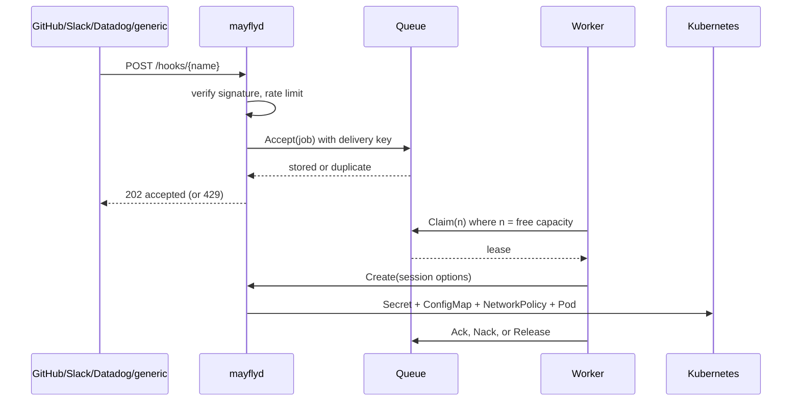
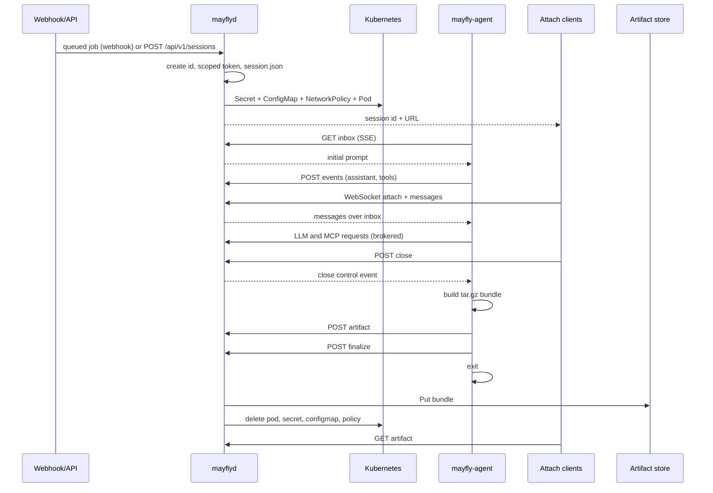

# Architecture

## Components

| Component | Responsibility |
|---|---|
| `mayflyd` | API, webhooks, session registry, thread bus, artifact storage, credential proxy, Kubernetes/local orchestration, timeouts, adoption |
| `mayfly-harness` | Image entrypoint: selects the named in-image harness or falls back to `mayfly-agent` |
| `mayfly-agent` | Built-in agent loop, MCP clients, built-in tools, conversation and trace logs, bundle assembly and upload |
| Agent manifest | Declarative agent name, prompt, model, skills, MCP servers, limits, optional runtime image |
| Web UI / CLI | Human attach over WebSocket, message send, close, artifact download |
| Kubernetes | Runs one pod per session with a per-session Secret and ConfigMap |
| Artifact store | Local filesystem or S3-compatible object storage |

The control plane and runtime communicate over HTTP. The runtime initiates every connection:

- `POST /internal/v1/sessions/{id}/events` — thread events.
- `GET /internal/v1/sessions/{id}/inbox` — server-sent stream of human messages and close requests.
- `POST /internal/v1/sessions/{id}/artifacts` — final bundle.
- `POST /internal/v1/sessions/{id}/finalize` — terminal status.
- `POST /internal/v1/llm/chat/completions` — model calls through the broker.
- `* /internal/v1/mcp/{server}` — MCP HTTP calls through the broker.

No inbound path to a session pod is required. The NetworkPolicy drops all ingress.

## Webhook intake

A webhook is accepted before any pod exists. `mayflyd` verifies the signature, spends one rate-limit token, and writes one job to the queue. The response is sent as soon as that write commits, so the sender never waits for Kubernetes.



Properties:

- Delivery key: `X-GitHub-Delivery`, Slack `trigger_id`, or an `Idempotency-Key` header. The same key accepted twice stores one job; the second response reports `duplicate: true`.
- Capacity: a worker claims only when `sessions.max_concurrent` has a free slot. A race returns `ErrCapacity`, which releases the job without counting an attempt.
- Retry: failures back off from `queue.retry_base`, doubling to ten minutes. A job that reaches `queue.max_attempts` is buried and appears in `queue.dead`.
- Visibility: a worker that dies mid-job loses its lease after `queue.visibility_timeout`; the job becomes claimable again. Delivery is at least once: if a worker creates the session and stops before acknowledging the job, the job runs again after the timeout. A lease that expired cannot reschedule a job another worker now holds.
- Correlation: the job id is stored on the session (`trigger.job_id`), and the queue keeps a completed record for `queue.tombstone_ttl`, so either side can be found from the other.
- Dead letters: a job that exhausts `queue.max_attempts` is buried with its last error. `GET /api/v1/queue/dead` lists buried jobs; the admin API can retry or delete them.
- Crash safety: `bbolt` and `redis` survive a control-plane restart. The `memory` backend does not.
- Deferred: lease renewal. `queue.visibility_timeout` is still a duration guess; a heartbeat on the store would turn it into a crash detector and is required before running more than one replica against a shared Redis. It is not implemented in 0.1.

## Lifecycle



## State model

| Status | Meaning |
|---|---|
| `pending` | Session reserved and container started (or starting); runtime not yet connected |
| `running` | Runtime opened its inbox stream and accepts messages |
| `closing` | Close requested (API, TTL expiry, or control-plane idle timeout); waiting for finalize |
| `completed` | Runtime uploaded its bundle and reported success |
| `expired` | Finalized after the TTL ran out: a success report with reason `ttl`/`expired`, or a fallback export after an `expired` close |
| `failed` | Start failure, runtime failure report, delete, or fallback export |

Transitions:

```text
pending  -> running                        runtime opens GET /internal/v1/sessions/{id}/inbox
pending  -> closing                        TTL runs out before the runtime connects, or POST close
running  -> closing                        POST close, TTL runs out, or idle for idle_timeout + 2m
pending | running | closing -> completed | expired | failed
                                           runtime finalize (POST /internal/v1/sessions/{id}/finalize)
pending | running | closing -> failed | expired
                                           fallback export (no connect, pod failed or missing,
                                           runtime exited, close grace exceeded)
pending | running | closing -> failed      DELETE /api/v1/sessions/{id}
```

A runtime can finalize straight from `running` without a close request. The built-in runtime does this on its own idle timer (`idle_timeout`, reported as `completed`), on its own TTL timer (TTL + 60 s, reported as `expired`), and on SIGTERM (reported as `completed`). Because the runtime's idle timer fires before the control plane's `idle_timeout + 2m` check, an idle session normally ends without passing through `closing`.

`finalize` runs once per session; later reports are ignored. The manager maps a successful runtime finalize to `expired` when the close reason was `expired` or the reported reason is `ttl` or `expired`. A fallback export ends in `expired` when the close reason was `expired`, otherwise `failed`.

If `runner.Start` fails, `Create` marks the session `failed` immediately and returns the error; a queued webhook job is then retried (`Nack`). A `pending` session moves to `running` only when its runtime authenticates to the control plane. If the runtime has not connected within `sessions.connect_timeout` (default `2m`, measured from when the pod reaches `Running`, or from launch on the local backend), the manager exports a partial artifact, stops the container, and marks the session `failed`, which releases its capacity slot.

## Thread model

One in-memory stream per session holds ordered events with a monotonic sequence. Each event has a type, optional actor, text, and data.

- Humans append `user_message`.
- The runtime appends `assistant_message`, `assistant_delta`, `tool_call`, `tool_result`, `system`, `error`, and `artifact`.
- The control plane appends lifecycle `status` events and internal `control` events.

The runtime receives only `user_message` and `control` events on its inbox. This prevents the agent from re-processing its own messages.

Retention is bounded per session (`sessions.event_buffer`, default 5000 events). Finalized sessions are dropped from memory after `sessions.retention` (default `30m`); live session records and thread buffers are lost on restart. Durable history is in the artifact bundle, not in the control plane database.

## Artifact format

`<timestamp>-<session>.tar.gz` contains:

| Entry | Content |
|---|---|
| `manifest.json` | session id, title, agent, model, status, reason, skills, MCP servers, counts, file list, partial flag, truncation flag |
| `events.jsonl` | thread events (streaming deltas excluded) |
| `conversation.jsonl` | full model-visible message history |
| `traces.jsonl` | LLM requests/responses, tool calls/results, durations |
| `files/...` | workspace files |
| `session.json` | runtime configuration for the session |

`manifest.json` is written last and lists every other entry. The upload is content-addressed by SHA-256 and verified by the control plane.

## Failure handling

| Failure | Behavior |
|---|---|
| Pod cannot start | `runner.Start` error: session `failed` immediately, no bundle. Image pull or container-config errors on a pending pod: fallback export after 30 s (`InvalidImageName` at once) |
| Runtime exits without finalize | 20 s after the pod reaches `Succeeded`/`Failed` (5 s after process exit on the local backend), the control plane exports logs and retained events as a partial bundle |
| Pod disappears | After 30 s, same fallback |
| Close does not finalize | After `sessions.close_grace` (default 90 s), force stop and fallback export |
| Artifact upload fails | Runtime retries 3 times, then finalizes as `failed` with no bundle. The control-plane fallback runs only if that finalize report also fails and the runtime exits |
| Control plane restarts | Running pods labeled `mayfly.io/managed=true` are adopted from their ConfigMap and Secret; new events continue but the pre-restart thread buffer is lost |
| TTL elapses | Close with reason `expired`; runtime finalizes; status becomes `expired` |

The local backend uses a child process, a per-session state directory, and the same HTTP protocol. It provides no isolation and is for development and tests only.

## Concurrency

- One control plane process owns each session; there is no leader election. Run one replica.
- The runtime executes one agent turn at a time. Up to 32 additional human messages are buffered; beyond that, messages are dropped and an `error` event says so.
- WebSocket clients share the session thread; every user message is broadcast to other clients and delivered to the runtime once.
- Subscribers have bounded buffers. Slow attach clients can miss live events; reconnect replays the retained backlog.
