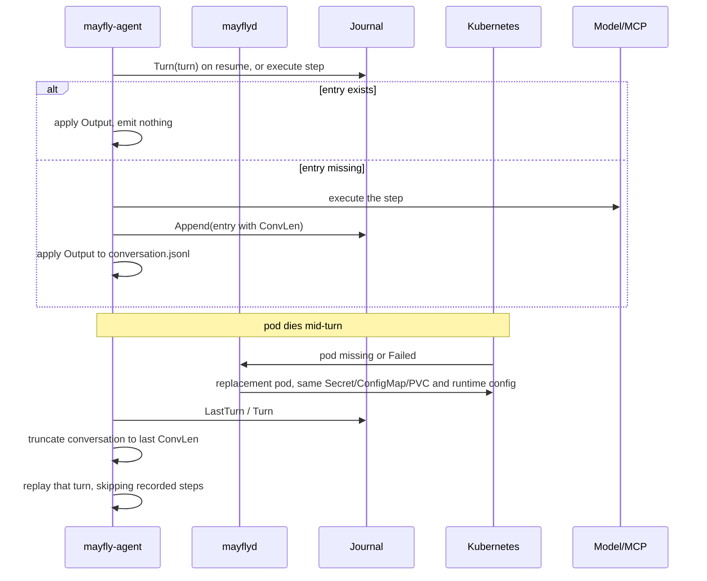

# Architecture

This page describes the system as of 1.0.0-rc.2: one control plane (`mayflyd`) that queues work, starts one short-lived runtime per session, brokers every credential the runtime needs, and keeps the state that lets a session survive a container or control-plane restart. Configuration keys are in [configuration.md](configuration.md); the HTTP surface is in [api.md](api.md).

## Components

| Component | Responsibility |
|---|---|
| `mayflyd` | Admin API and web UI, webhooks, queue and worker, scheduler, session registry, thread bus, turn journal, session record store, artifact storage, credential broker, tool gateway, skills loading, Kubernetes or local orchestration, timeouts, adoption, metrics |
| `mayfly-harness` | Image entrypoint: selects the named in-image harness or falls back to `mayfly-agent` |
| `mayfly-agent` | Built-in agent loop, MCP clients, plugin host, built-in tools, conversation and trace logs, bundle assembly and upload |
| `mayfly-plugin-shim` | Copies inline plugin trees into the pod, and serves a stdio plugin over streamable HTTP on a Unix socket or TCP for sidecar and service plugins |
| Tool gateway | One choke point for every non-built-in tool call: grant, ledger, idempotency key, timeouts, rate limits, call tokens, audit |
| Plugin workload | `inline` child in the agent container, `sidecar` container in the session pod, or reconciled `service` Deployment |
| Agent manifest | Declarative agent name, prompt, model, skills, MCP servers, plugins, limits, optional runtime image |
| Web UI / CLI | Human attach over WebSocket, message send, close, artifact download |
| Queue | Durable job store (`memory`, `bbolt`, or `redis`) in front of session creation. Webhooks, schedules, and your own producers write `job.v1` envelopes to it |
| Scheduler and sources | Cron slots that run a declarative source chain and start a session only on a material change |
| Turn journal and record store | Completed turn steps and the tool ledger for resume; session records and the artifact index for the list and downloads after a restart |
| Runtime backend | `kubernetes`: one pod per session with a Secret, ConfigMap, NetworkPolicy, and workspace PersistentVolumeClaim. `local`: one child process per session, for development |
| Artifact store | Local filesystem or S3-compatible object storage |

The control plane and runtime communicate over HTTP. The runtime initiates every connection:

- `POST /internal/v1/sessions/{id}/events` — thread events. An event may carry `step_key`; a repeated key is dropped.
- `GET /internal/v1/sessions/{id}/inbox` — server-sent stream of human messages and close requests. A pending message accepted before a control-plane restart is redelivered here under its reserved sequence.
- `POST /internal/v1/sessions/{id}/journal` — one completed turn step.
- `GET /internal/v1/sessions/{id}/journal?turn=N` — the steps of one turn; without `turn`, the last turn.
- `POST /internal/v1/sessions/{id}/artifacts` — final bundle.
- `GET /internal/v1/sessions/{id}/artifacts?key=...&offset=...&limit=...` — a window of an input artifact mounted on the session, such as a schedule run artifact. Backs the `read_artifact` tool.
- `POST /internal/v1/sessions/{id}/finalize` — terminal status.
- `POST /internal/v1/llm/chat/completions` — model calls through the broker.
- `GET /internal/v1/sessions/{id}/tools` — the session's tool grant, sidecar discovery tokens, and unavailable owners.
- `POST /internal/v1/sessions/{id}/tools/calls` — authorize one tool call. The answer is a recorded result or a dispatch with an idempotency key, a timeout, and for a sidecar a call token.
- `POST /internal/v1/sessions/{id}/tools/calls/complete` — the result of a locally dispatched call.
- `* /internal/v1/mcp/{server}` — HTTP MCP proxy for alternate harnesses. The built-in harness does not use it: the tool gateway discovers and calls HTTP servers.

No inbound path to a session pod is required. The NetworkPolicy drops all ingress.

## Webhook intake

A webhook is accepted before any pod exists. `mayflyd` verifies the signature, spends one rate-limit token, and writes one job to the queue. The response is sent as soon as that write commits, so the sender never waits for Kubernetes.


Properties:

- Delivery key: `X-GitHub-Delivery`, Slack `trigger_id`, or an `Idempotency-Key` header. The same key accepted twice stores one job; the second response reports `duplicate: true`.
- Capacity: a worker claims only when `sessions.max_concurrent` has a free slot. A race returns `ErrCapacity`, which releases the job without counting an attempt.
- Retry: each claim counts an attempt, so a crash or handler panic cannot retry a job forever. A recovered panic is logged with its stack and Nacked. Failures back off from `queue.retry_base`, doubling to ten minutes. A job that reaches `queue.max_attempts` is buried in the dead set.
- Visibility: a worker that dies mid-job loses its lease after `queue.visibility_timeout`; the job becomes claimable again. Delivery is at least once: if a worker creates the session and stops before acknowledging the job, the job runs again after the timeout. A lease that expired cannot reschedule a job another worker now holds.
- Correlation: the job id is stored on the session (`trigger.job_id`), and the queue keeps a completed record for `queue.tombstone_ttl`, so either side can be found from the other.
- Dead letters: a job that exhausts `queue.max_attempts` is buried with its last error. `GET /api/v1/queue/dead` lists buried jobs; the admin API can retry or delete them.
- Crash safety: `bbolt` and `redis` survive a control-plane restart. The `memory` backend does not.
- Lease renewal: while a handler runs, the worker extends its lease every third of `queue.visibility_timeout` (`Store.Extend`), so `visibility_timeout` detects a crashed worker instead of bounding job length. Each handler has its own deadline: `sources.job_timeout` for schedule jobs, 5 minutes for other kinds. A renewal that fails leaves the old lease to expire, and settling with a lease another worker now holds is rejected.

## Queue producers and the admin API

The queue has three producers. All of them write the same versioned envelope, `job.v1` ([queue-jobs.md](queue-jobs.md), schema in `api/job.v1.schema.json`), and the same worker runs every job:

| Producer | Kind | Idempotency key |
|---|---|---|
| Webhook intake (`POST /hooks/{name}`) | `session.create` | The sender's delivery key |
| Scheduler, on a cron slot or `POST /api/v1/schedules/{name}/run` | `source.run` | `schedule:<name>:<slot>` for a slot; random for a manual run |
| Your own system, writing to the queue backend directly (`redis` while `mayflyd` runs, because `bbolt` locks its file) | `session.create` | The envelope's `idempotency_key`, if set |

The API, CLI, and web UI do not use the queue: `POST /api/v1/sessions` creates a session directly and gets `429` with `Retry-After` when `sessions.max_concurrent` is full.

The worker decodes each envelope before it runs it. A payload that does not decode, an unknown major version, or an unknown kind is buried with the reason, so one bad job cannot stop the queue. A job id is also the session idempotency key, so a job that runs twice after a crash starts one session.

The queue admin API reads and repairs the queue without access to the backend:

| Route | Scope | Purpose |
|---|---|---|
| `GET /api/v1/queue` | `queue:read` | Pending, leased, and dead counts, and the oldest pending job |
| `GET /api/v1/queue/jobs/{id}` | `queue:read` | One job, including a completed job and its `session_id` for `queue.tombstone_ttl` |
| `GET /api/v1/queue/dead` | `queue:read` | Buried jobs with their last error, newest first |
| `POST /api/v1/queue/dead/{id}/retry` | `queue:write` | Requeue a buried job with its attempt count reset |
| `DELETE /api/v1/queue/dead/{id}` | `queue:write` | Drop a buried job |

## Schedules and sources

A schedule is a key of an agent manifest: a five-field UTC cron expression, a source, and a prompt template. A source chain is declared in the bundle (connections, sources, `extends`, fanout, extract, filter, change tracking), so provider knowledge lives in YAML, not Go. See [sources.md](sources.md).

On each slot the scheduler writes one `source.run` job. The worker runs the source chain in the control plane with the connection's credentials, writes the run artifact `runs/<schedule>/<run id>.json` to the artifact store, and creates a session only when the change totals match the schedule's `triggerOn`. The session mounts the run artifact read-only, and the agent reads it with `read_artifact`. A retried job reads the stored artifact instead of calling the providers again, because a provider's change tracking reports a change only once.

The scheduler keeps the last accepted slot of each schedule in a bbolt watermark (`sources.state_path`). Each slot is accepted once, so a restart cannot run the same slot twice. After downtime the scheduler catches up the most recent missed slot, up to seven days back. A schedule job has its own deadline, `sources.job_timeout`, and each source step `sources.timeout`.

## Lifecycle


Before the runtime accepts a prompt it starts its inline plugins, reads the
tool grant from the gateway, connects the session's sidecars with the discovery
tokens the grant carries, and compares each plugin's `tools/list` with the
manifest. A required plugin that is unavailable fails the session; an optional
one records a `system` event and its tools are not offered.

## Credential broker

The runtime holds one credential: a random session token, stored in the session's Secret and indexed by SHA-256 in the control plane. Every upstream credential stays in `mayflyd`.

- Model calls go to `POST /internal/v1/llm/chat/completions`. The broker sets the request's model to the session's assigned model, refuses any other model, injects `llm.api_key_env` and `llm.headers`, and streams the response. `llm.timeout` bounds the connection and the wait for response headers; a streamed body runs until the session disconnects. For several providers, point `llm.base_url` at LiteLLM ([providers.md](providers.md)).
- HTTP MCP servers are called by the tool gateway with headers resolved from `env:` references at startup. `* /internal/v1/mcp/{server}` proxies the same servers for alternate harnesses, which bypass the gateway.
- Object-store credentials are used only by the control plane, which uploads bundles and run artifacts.

The session token is removed from the index when the session finalizes or is deleted. [security.md](security.md#credential-boundary) lists what it authorizes.

## Tool gateway

A session's grant is fixed when it is created. `session.Manager` resolves the
agent's `plugins` and `mcpServers`, builds a grant with `gateway.GrantFor`, and
registers it before the pod starts. Adoption rebuilds the same grant from
`session.json` and the bundle. A wildcard `mcp.servers` entry is resolved
against the server's own tool list at call time.

The model sees built-in tools, `mcp_<server>_<tool>`, and
`plugin_<plugin>_<tool>`. Every non-built-in call follows one path:

| Placement | Who makes the call | Ledger |
|---|---|---|
| `inline`, `sidecar`, stdio `mcp.servers` | The runtime, after the gateway authorizes it; the runtime reports the result | Written at begin and complete |
| `service`, HTTP `mcp.servers` | The gateway, which holds the upstream client and credentials | Written and completed by the gateway |

The idempotency key is `<session>/<turn>/<step>`. The gateway hashes the
arguments and never stores them, and it caps a stored result at the tool's
output limit. On resume, a `done` record returns the recorded result with
`replayed`; a `pending` non-idempotent record returns an interrupted error
result and is marked done; a `pending` idempotent record is dispatched again
with the same key.

Service plugins are rendered from the bundle by `internal/pluginsvc`: a
Deployment, a Service, a NetworkPolicy, and a gateway key Secret. Reconcile runs
at startup and every `plugins.reconcile_interval`. Sidecar call tokens are
signed with the session's `gateway-key`; service call tokens with the
per-plugin key.

Before a call is dispatched the gateway applies, in order: the grant (a tool outside it is refused and counted as `tool="unknown"` in `mayfly_gateway_calls_total`), the plugin's `limits.rate` token bucket per session (`rate_limited`, `429` with `Retry-After`), and the process-wide in-flight cap `plugins.max_inflight_calls` (`busy`, `503`; the runtime retries within its budget). A replayed ledger result is not counted. Each call writes one `call.begin` and one `call.done` audit record to the process log, and to `plugins.audit_path` when set. The audit record carries neither arguments nor results.

If the gateway is unreachable, the runtime retries within a five-minute budget
and exits without finalizing, so a replacement container resumes the turn.

## Turn journal

A user message starts a turn. The runtime records the turn as a prefix of ordered steps:

| Step | Name | Meaning |
|---|---|---|
| 0 | `user` | The inbox event, recorded as `Input`; `Output` is the model-visible message |
| next | `llm` | A model response that requests tool calls |
| next.. | `tool:<name>` | One tool call, in the order requested |
| next | `assistant` | A terminal model response with no tool calls |

Each entry stores the turn key (the inbox event `Seq`), the step index, the input and output needed to apply it, and `ConvLen`, the size of `conversation.jsonl` after applying it. The runtime appends the entry before it appends the conversation line, then verifies the resulting size; a mismatch ends the process so a replacement resumes from the journal. Payloads also carry the thread events the step produced. The control plane publishes an assistant message or tool result only from the journal entry and uses a `step_key` for it, so a crash between the model response and the append cannot leave a visible reply the conversation does not contain. A tool call is emitted live, because it is deterministic once the model step is journaled, and the journal publication's copy is dropped by the same key.

The turn key is an inbox `Seq`, and a fresh hub numbers events from zero. On adoption the control plane seeds the hub above the highest journaled turn (`MaxTurn`) and the sequence floor the journal reserved for that session, so a new message never reuses a journaled turn key. Journal entry times are stamped by the control plane, and `LastTurn` follows write order rather than those clocks. The runtime also rejects a turn whose recorded step zero is not this exact message (type, actor, text, and time), and compares step inputs and step numbers during replay. Turn keys are reserved in blocks of 1000, one journal write per block.



On startup the runtime reads the journal; it does not need a flag, so a replacement's mounted config is unchanged. It takes the most recently written turn, rebuilds the turn event from step zero's recorded input, validates it, truncates `conversation.jsonl` down to the last entry's `ConvLen`, and starts its inbox at `LastTurn-1`. Recorded steps are applied only if the file is shorter than their `ConvLen`; missing steps execute. This makes `conversation.jsonl` authoritative only up to the journal, and the journal authoritative for which effects already happened. A journaled turn whose recorded event is not the message being handled is fatal rather than replayed.

A journal entry is deleted when its session finalizes. The artifact bundle is the durable history; the journal exists only to resume an active session.

Exactly-once external side effects hold for tools the gateway grants. A call that finished but whose journal step did not land replays its recorded result, and a non-idempotent call that was in flight when the container died is not repeated. Built-in tools are outside the ledger: `run_command` can repeat after a resume. Streaming assistant deltas are not journaled, so the interrupted step can show duplicate deltas after a retry.

## State model

| Status | Meaning |
|---|---|
| `pending` | Session reserved and container started (or starting); runtime not yet connected |
| `running` | Runtime opened its inbox stream and accepts messages |
| `closing` | Close requested (API, TTL expiry, or control-plane idle timeout); waiting for finalize |
| `completed` | Runtime uploaded its bundle and reported success |
| `expired` | Finalized after the TTL ran out: a success report with reason `ttl`/`expired`, or a fallback export after an `expired` close |
| `failed` | Start failure, runtime failure report, delete, or fallback export |

Transitions:

```text
pending  -> running                        runtime opens GET /internal/v1/sessions/{id}/inbox
pending  -> closing                        TTL runs out before the runtime connects, or POST close
running  -> closing                        POST close, TTL runs out, or idle for idle_timeout + 2m
pending | running | closing -> completed | expired | failed
                                           runtime finalize (POST /internal/v1/sessions/{id}/finalize)
pending | running | closing -> failed | expired
                                           fallback export (no connect, pod failed or missing,
                                           runtime exited, close grace exceeded)
pending | running | closing -> failed      DELETE /api/v1/sessions/{id}
```

A replacement container does not add a status. A `pending` or `running` session whose pod fails keeps its status while a new pod starts; `RuntimeConnected` is idempotent. The session becomes `failed` only when the last replacement attempt fails and the fallback export runs.

A runtime can finalize straight from `running` without a close request. The built-in runtime does this on its own idle timer (`idle_timeout`, reported as `completed`), on its own TTL timer (TTL + 60 s, reported as `expired`), and on SIGTERM (reported as `completed`). Because the runtime's idle timer fires before the control plane's `idle_timeout + 2m` check, an idle session normally ends without passing through `closing`.

`finalize` runs once per session; later reports are ignored. The manager maps a successful runtime finalize to `expired` when the close reason was `expired` or the reported reason is `ttl` or `expired`. A fallback export ends in `expired` when the close reason was `expired`, otherwise `failed`.

If `runner.Start` fails, `Create` marks the session `failed` immediately and returns the error; a queued webhook job is then retried (`Nack`). A `pending` session moves to `running` only when its runtime authenticates to the control plane. If the runtime has not connected within `sessions.connect_timeout` (default `2m`, measured from launch, so time the pod spends `Pending` counts), the manager exports a partial artifact, stops the container, and marks the session `failed`, which releases its capacity slot.

The manager writes each transition to the session record store (`sessions.records`: `bbolt` at `sessions.db` beside the journal, or `memory`). A record holds the fields `List` and `Get` serve, including the artifact metadata, and no token: an adopted session reads its token back from its Secret, and a finalized session does not accept one. At startup the manager adopts pods first and then loads the store. A finished record becomes a list entry. A record for a session that adoption did not rebuild is marked `failed`, because no runtime can continue its turn. Records leave the store after `sessions.retention`; artifact metadata leaves after `artifacts.index_retention`. A record this build cannot read stops startup rather than serving a partial list.

## Thread model

One in-memory stream per session holds ordered events with a monotonic sequence. Each event has a type, optional actor, text, and data.

- Humans append `user_message`.
- The runtime appends `assistant_message`, `assistant_delta`, `tool_call`, `tool_result`, `system`, `error`, and `artifact`.
- The control plane appends lifecycle `status` events and internal `control` events.

The runtime receives only `user_message` and `control` events on its inbox. This prevents the agent from re-processing its own messages.

An event may carry a per-event `step_key`. The hub drops a repeat of the same key within a session, so a step that executed but did not reach the journal before a crash cannot post its assistant or tool message twice. Restore uses the same keys, so a retried journal append cannot duplicate an event that adoption already showed. Streaming `assistant_delta` events have no key and may repeat for the interrupted step. The internal events endpoint has no batch-level key.

Retention is bounded per session (`sessions.event_buffer`, default 5000 events). Finalized sessions are dropped from memory after `sessions.retention` (default `30m`). Thread buffers are lost on restart; session records survive it in the record store (see [State model](#state-model)). On adoption, the last journaled turn's events are replayed into the new thread (without entering the inbox), so a control-plane restart does not lose the in-flight turn from the UI. Durable history is the artifact bundle plus the journal.

A message accepted before its turn starts is also durable. `PostMessage` and
`Create` write a pending-inbox record to the journal, keyed by the session and
the event sequence that will become the turn key, before they acknowledge the
caller. The record is deleted in the same journal transaction that appends step
0 of the turn. Adoption reads the remaining records and puts each event back on
the new hub's inbox under its original sequence, and restores a thread copy
with a new sequence. Keeping the sequence is what makes redelivery idempotent:
the runtime's inbox cursor treats an event it already read as consumed, and the
step-0 identity check (`sameTurnEvent`) replays the journaled turn instead of
starting a second one. The runtime applies backpressure when its in-memory
message queue is full instead of dropping the message, so a connected runtime
keeps the same guarantee.

## Artifact format

`<timestamp>-<session>.tar.gz` contains:

| Entry | Content |
|---|---|
| `manifest.json` | session id, title, agent, harness, model, status, reason, skills, MCP servers, plugins, counts, file list, partial flag, truncation flag |
| `events.jsonl` | thread events (streaming deltas excluded) |
| `conversation.jsonl` | full model-visible message history |
| `traces.jsonl` | LLM requests/responses, tool calls/results, durations |
| `files/...` | workspace files and one `plugins/<name>.stderr.log` per inline plugin |
| `session.json` | runtime configuration for the session |

`manifest.json` is written last and lists every other entry. The upload is content-addressed by SHA-256 and verified by the control plane. The index that serves downloads lives in the session record store, so a restart does not lose the mapping from session to bundle.

## Failure handling

| Failure | Behavior |
|---|---|
| Pod cannot start | `runner.Start` error: session `failed` immediately, no bundle. Invalid, missing, or unreadable image and container configuration is replaced immediately; an image pull gets 30 s to recover. Replace up to `sessions.max_restarts`, then fallback |
| Pod fails or disappears while `pending`/`running` | A replacement pod starts with the same session, Secret, ConfigMap, NetworkPolicy, workspace claim, and runtime config; it finds the journal on startup. Up to `sessions.max_restarts` (default 2); fallback only after the last attempt. A pod that is terminating for 30 s or Running but not ready for 60 s is treated as missing. Replacements run in the background so polling continues for other sessions. `sessions.persistent_workspace: false` disables replacement, because the turn and workspace cannot be resumed |
| Runtime exits without finalize | A pod that reaches `Succeeded` falls back after 20 s. A `Failed` pod is replaced while attempts remain, then falls back. On the local backend, a child exit after 2 s starts a replacement process in the same state directory |
| Close does not finalize | After `sessions.close_grace` (default 90 s), force stop and fallback export |
| Artifact upload fails | Runtime retries 3 times, then finalizes as `failed` with no bundle. The control-plane fallback runs only if that finalize report also fails and the runtime exits |
| Tool gateway unreachable | The runtime retries each begin and complete for up to 5 minutes, then exits without finalizing so a replacement resumes. It never runs a tool without a successful begin |
| Tool call interrupted by a restart | Non-idempotent: the gateway returns an interrupted error result and the runtime emits a `system` event. Idempotent: the call is dispatched again with the same key. A completed call whose journal step did not land replays the recorded result |
| Plugin unavailable | `required: true` fails the session at start. Otherwise a `system` event and the session continues without its tools |
| Control plane restarts | Running pods labeled `mayfly.io/managed=true` are adopted from their ConfigMap and Secret, the hub is seeded above the reserved sequence floor, and the last journaled turn is restored to the thread with its step keys. A runtime in flight retries transient model, tool gateway, and journal requests through the replacement control plane for up to 5 minutes per step, then exits so a replacement resumes. A session that lost its pod but kept its ConfigMap, Secret, and workspace claim gets a replacement pod at startup. A pod whose ConfigMap is gone belongs to a session that finalized mid-cleanup (cleanup deletes the ConfigMap first) and is deleted. The rest of the objects are garbage-collected. Finished sessions and artifact metadata are read back from the session record store. With no journal state at all (persistence off), the hub is seeded at the current time in microseconds, so new messages never reuse the in-flight turn's key |
| TTL elapses | Close with reason `expired`; runtime finalizes; status becomes `expired` |
| SIGTERM or SIGINT | A drain, eviction, preemption, or `kubectl delete` is not a close. The runtime stops the turn, closes its logs, and exits non-zero without finalizing, so the control plane starts a replacement. It finalizes when a close control event was received, or with its full bundle when the session cannot resume (`sessions.max_restarts: 0`, or a Kubernetes session without a persistent workspace) |

## Runtime backends

`runtime.backend` selects how a session runs. Both backends speak the same `/internal/v1` protocol, so the control plane, journal, and gateway behave the same.

| | `kubernetes` (default) | `local` |
|---|---|---|
| Unit | One pod per session in `sessions.namespace`, from `runtime.image` or the agent manifest's image (checked against `agents.allowed_images`) | One child process of `mayflyd` per session, from `runtime.agent_binary` |
| Per-session objects | Secret (session token and gateway signing keys), ConfigMap (`session.json`), NetworkPolicy (`runtime.network_policy`), and a workspace PersistentVolumeClaim when `sessions.persistent_workspace` is on | A state directory under `runtime.state_dir` |
| Isolation | Non-root container, no service-account token, ingress denied, egress limited to DNS, the control plane, and `runtime.egress` CIDRs | None. The child gets a minimal environment, but shares the host's network and filesystem |
| Plugins | `inline` copied in by an init container, `sidecar` as a native sidecar, `service` as a reconciled Deployment | `inline` and `sidecar` as children of the runtime; `service` as a child of `mayflyd` on a Unix socket |
| Restart | A replacement pod with the same objects and claim, up to `sessions.max_restarts` | A replacement process in the same state directory |
| Adoption | Pods labeled `mayfly.io/managed=true` are adopted after a control-plane restart | Not supported |

The local backend is for development and tests only. The state directory, including `conversation.jsonl`, survives a child restart, so a replacement resumes the journaled turn.

## Storage

Every store the control plane writes carries a format version ([configuration.md](configuration.md#persisted-formats)). The chart puts every file on one control-plane PersistentVolume at `/var/lib/mayfly`.

| Store | Backends | Holds | Lifetime |
|---|---|---|---|
| Queue (`queue`) | `memory`, `bbolt`, `redis` | Pending, leased, and dead jobs, dedupe keys, completed-job tombstones | Dedupe keys for `queue.dedupe_ttl`, tombstones for `queue.tombstone_ttl`, dead jobs until retried or deleted |
| Turn journal (`journal`) | `memory`, `bbolt` | Completed turn steps, the sequence floor, the tool ledger | Deleted when the session finalizes |
| Session records (`sessions.records`) | `memory`, `bbolt` (`sessions.db` beside the journal by default) | Session list entries and the artifact index | Records for `sessions.retention`; the artifact index for `artifacts.index_retention` |
| Schedule watermark (`sources.state_path`) | bbolt file, or memory when empty | Last accepted slot per schedule | Kept |
| Artifacts (`artifacts`) | `local`, `s3` (any S3-compatible store) | Session bundles and schedule run artifacts | Managed by you |
| Skill cache (`skills.cache_dir`) | Directory of `<sha256>.tar.gz` files | Verified skill source archives | Entries no configured source names are deleted at startup |

`bbolt` locks its file, so one control-plane replica owns each file. Run one replica.

## API authentication and the web UI

Every `/api/v1` route requires one scope: `sessions:read`, `sessions:write`, `queue:read`, `queue:write`, `schedules:read`, or `schedules:write`. `admin` grants all of them and is also required for `/metrics` on the main port. Tokens are named in `server.tokens`, each with its scopes, a `secret_env`, and an optional `expires_at`. With no `server.tokens`, the secret in `server.token_env` (`MAYFLY_API_TOKEN`) is one `admin` token named `default`. Tokens are compared in constant time and never logged.

The web UI sends a token once to `POST /api/v1/auth/session` and gets two cookies: `mayfly_session` (HttpOnly) and `mayfly_csrf`, both `SameSite=Strict` and `Secure` over https. The session lives in control-plane memory for up to 12 hours, capped by the token's expiry, and carries the token's scopes. A cookie-authenticated mutating request must send `X-Mayfly-CSRF` with the `mayfly_csrf` value and pass an `Origin` check. A request with a bearer header is authenticated by that header alone. A restart signs every browser out.

Every authenticated mutating request writes one `audit` log line with the token name, `via` (`bearer` or `web`), route, target, status, and request id. The attach WebSocket uses a one-time ticket from `POST /api/v1/sessions/{id}/attach-ticket`. See [security.md](security.md#api-authentication).

## Skills

Skills are Markdown files from `skills.dirs` and from pinned `skills.sources` tar.gz archives. The control plane fetches each archive at startup, checks it against the configured SHA-256, and stores it in `skills.cache_dir` under that digest, so a later start reads the cache and needs no network. The selected skills are written into the session's configuration and appended to the system prompt; sessions never contact the code host. See [mcp-and-skills.md](mcp-and-skills.md#skills).

## Metrics and logs

`/metrics` serves Prometheus metrics on `server.addr`, or on `server.metrics.address` as a listener of its own. The registry covers sessions, queue depth and attempts, HTTP requests, model calls, gateway calls, recovered panics (`mayfly_panics_total{component}`), and build info, plus the Go and process collectors. Labels are bounded: `route` is the registered route template or `unmatched`, `method` is a standard HTTP method or `OTHER`, and a refused call to a tool the session does not have is `tool="unknown"`. No metric carries a session id, job id, or raw path.

Each HTTP request writes one structured log line with its request id. The control plane accepts a well-formed `X-Request-Id` or generates one, and returns it in the response header and in `error.details.request_id`. `MAYFLY_LOG_LEVEL` sets the level. See [observability.md](observability.md).

## Concurrency

- One control plane process owns each session; there is no leader election. Run one replica.
- The runtime executes one agent turn at a time. Up to 32 additional human messages are buffered; beyond that, messages are dropped and an `error` event says so.
- The journal is append-only per session and turn, and deleted when the session finalizes. A step is written before its conversation effect, so the journal wins over a partially applied conversation. The control plane is the only writer for a session's journal and the only writer of the sequence floor.
- One replacement container may exist per session; `pollPods` matches only the current pod name, and the restart guard ignores overlapping failure observations.
- WebSocket clients share the session thread; every user message is broadcast to other clients and delivered to the runtime once.
- Subscribers have bounded buffers. Slow attach clients can miss live events; reconnect replays the retained backlog.

## Non-goals for this version

- Multi-tenant SaaS with per-user isolation.
- Long-running agent workspaces that outlive a session. `sessions.persistent_workspace` keeps a workspace across container restarts within one session only.
- Replacing commercial SRE agents.
- Workflow DAGs. A schedule runs one source chain and starts at most one session; there is no multi-step orchestration.
- Native GCS/Artifact Registry artifact backends.

## Project layout

| Path | Purpose |
|---|---|
| `cmd/mayflyd` | control plane |
| `cmd/mayfly-harness` | image entrypoint: selects an in-image harness or Mayfly fallback |
| `cmd/mayfly-agent` | built-in session runtime |
| `cmd/mayfly-plugin-shim` | copies plugin trees into a pod and serves a stdio plugin over HTTP |
| `cmd/mayfly` | CLI |
| `cmd/llmstub`, `cmd/mcpstub` | deterministic LLM and MCP stub servers for k3d and local runs |
| `internal/session` | lifecycle, thread, agent registry, artifact export |
| `internal/agents` | agent manifest loading and prompt templates |
| `internal/plugin` | plugin manifest, validation, and names |
| `internal/gateway` | tool grant, ledger, call tokens, rate limits, audit, remote dispatch |
| `internal/pluginhost` | inline supervisor and sidecar client |
| `internal/pluginsvc` | service plugin reconcile and local service children |
| `internal/httpapi` | API, web UI, webhooks, WebSocket |
| `internal/k8s` | pod, secret, config map, NetworkPolicy, plugin volumes and sidecars |
| `internal/agent` | agent loop, tools, traces, bundle |
| `internal/mcp`, `internal/llm` | protocol clients |
| `internal/broker` | LLM and MCP credential proxy |
| `internal/artifact` | local and S3-compatible stores |
| `internal/queue` | job store (memory, bbolt, Redis protocol) and worker |
| `internal/workflow`, `internal/sources`, `internal/state` | schedules, source chains, and their watermarks |
| `internal/journal` | turn journal and tool-call ledger storage |
| `internal/triggers` | webhook verification and prompt building |
| `internal/skills` | skill loading, remote sources, and the archive cache |
| `internal/hub` | in-memory event thread and fan-out |
| `internal/metrics` | Prometheus registry |
| `internal/config`, `internal/project` | config and project bundle loading |
| `internal/bundle` | session artifact bundle format |
| `internal/runner` | Kubernetes and local execution backends |
| `internal/ratelimit` | token-bucket limiter |
| `api` | OpenAPI spec and queue job schema |
| `docs` | operator and developer docs |
| `examples/plugins` | Go sidecar, Python service, and TypeScript inline examples |
| `deploy/k8s` | base manifests and local overlay |
| `deploy/helm/mayfly` | Helm chart with optional LiteLLM |
| `hack` | local run, k3d cluster, e2e runner |
| `e2e` | end-to-end suite against a deployed release |
| `test` | in-process integration tests and persisted-format compatibility fixtures |
