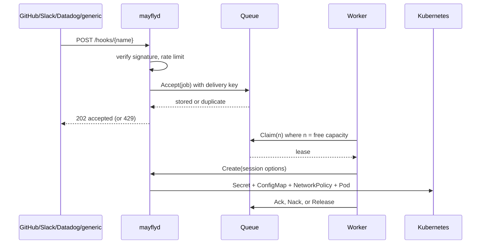
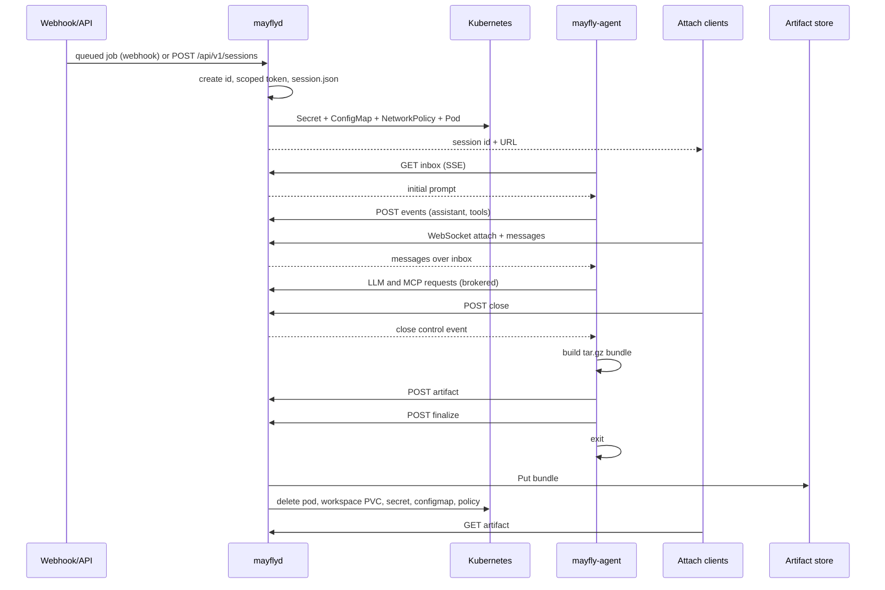
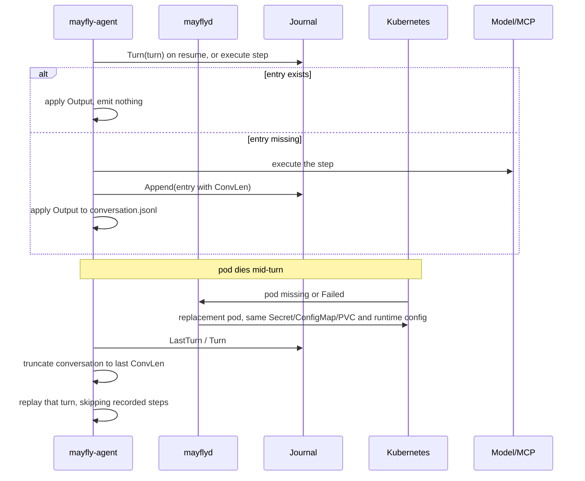

# Architecture

## Components

| Component | Responsibility |
|---|---|
| `mayflyd` | API, webhooks, session registry, thread bus, artifact storage, credential proxy, tool gateway, Kubernetes/local orchestration, timeouts, adoption |
| `mayfly-harness` | Image entrypoint: selects the named in-image harness or falls back to `mayfly-agent` |
| `mayfly-agent` | Built-in agent loop, MCP clients, plugin host, built-in tools, conversation and trace logs, bundle assembly and upload |
| `mayfly-plugin-shim` | Copies inline plugin trees into the pod, and serves a stdio plugin over streamable HTTP on a Unix socket or TCP for sidecar and service plugins |
| Tool gateway | One choke point for every non-built-in tool call: grant, ledger, idempotency key, timeouts, rate limits, call tokens, audit |
| Plugin workload | `inline` child in the agent container, `sidecar` container in the session pod, or reconciled `service` Deployment |
| Agent manifest | Declarative agent name, prompt, model, skills, MCP servers, plugins, limits, optional runtime image |
| Web UI / CLI | Human attach over WebSocket, message send, close, artifact download |
| Kubernetes | Runs one pod per session with a per-session Secret and ConfigMap |
| Artifact store | Local filesystem or S3-compatible object storage |

The control plane and runtime communicate over HTTP. The runtime initiates every connection:

- `POST /internal/v1/sessions/{id}/events` — thread events. An event may carry `step_key`; a repeated key is dropped.
- `GET /internal/v1/sessions/{id}/inbox` — server-sent stream of human messages and close requests.
- `POST /internal/v1/sessions/{id}/journal` — one completed turn step.
- `GET /internal/v1/sessions/{id}/journal?turn=N` — the steps of one turn; without `turn`, the last turn.
- `POST /internal/v1/sessions/{id}/artifacts` — final bundle.
- `POST /internal/v1/sessions/{id}/finalize` — terminal status.
- `POST /internal/v1/llm/chat/completions` — model calls through the broker.
- `GET /internal/v1/sessions/{id}/tools` — the session's tool grant, sidecar discovery tokens, and unavailable owners.
- `POST /internal/v1/sessions/{id}/tools/calls` — authorize one tool call. The answer is a recorded result or a dispatch with an idempotency key, a timeout, and for a sidecar a call token.
- `POST /internal/v1/sessions/{id}/tools/calls/complete` — the result of a locally dispatched call.
- `* /internal/v1/mcp/{server}` — MCP HTTP calls through the broker. The built-in harness uses it to list a server's tools; alternate harnesses also call tools through it.

No inbound path to a session pod is required. The NetworkPolicy drops all ingress.

## Webhook intake

A webhook is accepted before any pod exists. `mayflyd` verifies the signature, spends one rate-limit token, and writes one job to the queue. The response is sent as soon as that write commits, so the sender never waits for Kubernetes.



Properties:

- Delivery key: `X-GitHub-Delivery`, Slack `trigger_id`, or an `Idempotency-Key` header. The same key accepted twice stores one job; the second response reports `duplicate: true`.
- Capacity: a worker claims only when `sessions.max_concurrent` has a free slot. A race returns `ErrCapacity`, which releases the job without counting an attempt.
- Retry: failures back off from `queue.retry_base`, doubling to ten minutes. A job that reaches `queue.max_attempts` is buried and appears in `queue.dead`.
- Visibility: a worker that dies mid-job loses its lease after `queue.visibility_timeout`; the job becomes claimable again. Delivery is at least once: if a worker creates the session and stops before acknowledging the job, the job runs again after the timeout. A lease that expired cannot reschedule a job another worker now holds.
- Correlation: the job id is stored on the session (`trigger.job_id`), and the queue keeps a completed record for `queue.tombstone_ttl`, so either side can be found from the other.
- Dead letters: a job that exhausts `queue.max_attempts` is buried with its last error. `GET /api/v1/queue/dead` lists buried jobs; the admin API can retry or delete them.
- Crash safety: `bbolt` and `redis` survive a control-plane restart. The `memory` backend does not.
- Lease renewal: while a handler runs, the worker extends its lease every third of `queue.visibility_timeout` (`Store.Extend`), so `visibility_timeout` detects a crashed worker instead of bounding job length. Each handler has its own deadline: `sources.job_timeout` for schedule jobs, 5 minutes for other kinds. A renewal that fails leaves the old lease to expire, and settling with a lease another worker now holds is rejected.

## Lifecycle



Before the runtime accepts a prompt it starts its inline plugins, reads the
tool grant from the gateway, connects the session's sidecars with the discovery
tokens the grant carries, and compares each plugin's `tools/list` with the
manifest. A required plugin that is unavailable fails the session; an optional
one records a `system` event and its tools are not offered.

## Tool gateway

A session's grant is fixed when it is created. `session.Manager` resolves the
agent's `plugins` and `mcpServers`, builds a grant with `gateway.GrantFor`, and
registers it before the pod starts. Adoption rebuilds the same grant from
`session.json` and the bundle. A wildcard `mcp.servers` entry is resolved
against the server's own tool list at call time.

The model sees built-in tools, `mcp_<server>_<tool>`, and
`plugin_<plugin>_<tool>`. Every non-built-in call follows one path:

| Placement | Who makes the call | Ledger |
|---|---|---|
| `inline`, `sidecar`, stdio `mcp.servers` | The runtime, after the gateway authorizes it; the runtime reports the result | Written at begin and complete |
| `service`, HTTP `mcp.servers` | The gateway, which holds the upstream client and credentials | Written and completed by the gateway |

The idempotency key is `<session>/<turn>/<step>`. The gateway hashes the
arguments and never stores them, and it caps a stored result at the tool's
output limit. On resume, a `done` record returns the recorded result with
`replayed`; a `pending` non-idempotent record returns an interrupted error
result and is marked done; a `pending` idempotent record is dispatched again
with the same key.

Service plugins are rendered from the bundle by `internal/pluginsvc`: a
Deployment, a Service, a NetworkPolicy, and a gateway key Secret. Reconcile runs
at startup and every `plugins.reconcile_interval`. Sidecar call tokens are
signed with the session's `gateway-key`; service call tokens with the
per-plugin key. The audit record carries neither arguments nor results.

If the gateway is unreachable, the runtime retries within a five-minute budget
and exits without finalizing, so a replacement container resumes the turn.

## Turn journal

A user message starts a turn. The runtime records the turn as a prefix of ordered steps:

| Step | Name | Meaning |
|---|---|---|
| 0 | `user` | The inbox event, recorded as `Input`; `Output` is the model-visible message |
| next | `llm` | A model response that requests tool calls |
| next.. | `tool:<name>` | One tool call, in the order requested |
| next | `assistant` | A terminal model response with no tool calls |

Each entry stores the turn key (the inbox event `Seq`), the step index, the input and output needed to apply it, and `ConvLen`, the size of `conversation.jsonl` after applying it. The runtime appends the entry before it appends the conversation line, then verifies the resulting size; a mismatch ends the process so a replacement resumes from the journal. Payloads also carry the thread events the step produced. The control plane publishes an assistant message or tool result only from the journal entry and uses a `step_key` for it, so a crash between the model response and the append cannot leave a visible reply the conversation does not contain. A tool call is emitted live, because it is deterministic once the model step is journaled, and the journal publication's copy is dropped by the same key.

The turn key is an inbox `Seq`, and a fresh hub numbers events from zero. On adoption the control plane seeds the hub above the highest journaled turn (`MaxTurn`) and the sequence floor the journal reserved for that session, so a new message never reuses a journaled turn key. Journal entry times are stamped by the control plane, and `LastTurn` follows write order rather than those clocks. The runtime also rejects a turn whose recorded step zero is not this exact message (type, actor, text, and time), and compares step inputs and step numbers during replay. Turn keys are reserved in blocks of 1000, one journal write per block.



On startup the runtime reads the journal; it does not need a flag, so a replacement's mounted config is unchanged. It takes the most recently written turn, rebuilds the turn event from step zero's recorded input, validates it, truncates `conversation.jsonl` down to the last entry's `ConvLen`, and starts its inbox at `LastTurn-1`. Recorded steps are applied only if the file is shorter than their `ConvLen`; missing steps execute. This makes `conversation.jsonl` authoritative only up to the journal, and the journal authoritative for which effects already happened. A journaled turn whose recorded event is not the message being handled is fatal rather than replayed.

A journal entry is deleted when its session finalizes. The artifact bundle is the durable history; the journal exists only to resume an active session.

Exactly-once external side effects hold for tools the gateway grants. A call that finished but whose journal step did not land replays its recorded result, and a non-idempotent call that was in flight when the container died is not repeated. Built-in tools are outside the ledger: `run_command` can repeat after a resume. Streaming assistant deltas are not journaled, so the interrupted step can show duplicate deltas after a retry.

## State model

| Status | Meaning |
|---|---|
| `pending` | Session reserved and container started (or starting); runtime not yet connected |
| `running` | Runtime opened its inbox stream and accepts messages |
| `closing` | Close requested (API, TTL expiry, or control-plane idle timeout); waiting for finalize |
| `completed` | Runtime uploaded its bundle and reported success |
| `expired` | Finalized after the TTL ran out: a success report with reason `ttl`/`expired`, or a fallback export after an `expired` close |
| `failed` | Start failure, runtime failure report, delete, or fallback export |

Transitions:

```text
pending  -> running                        runtime opens GET /internal/v1/sessions/{id}/inbox
pending  -> closing                        TTL runs out before the runtime connects, or POST close
running  -> closing                        POST close, TTL runs out, or idle for idle_timeout + 2m
pending | running | closing -> completed | expired | failed
                                           runtime finalize (POST /internal/v1/sessions/{id}/finalize)
pending | running | closing -> failed | expired
                                           fallback export (no connect, pod failed or missing,
                                           runtime exited, close grace exceeded)
pending | running | closing -> failed      DELETE /api/v1/sessions/{id}
```

A replacement container does not add a status. A `pending` or `running` session whose pod fails keeps its status while a new pod starts; `RuntimeConnected` is idempotent. The session becomes `failed` only when the last replacement attempt fails and the fallback export runs.

A runtime can finalize straight from `running` without a close request. The built-in runtime does this on its own idle timer (`idle_timeout`, reported as `completed`), on its own TTL timer (TTL + 60 s, reported as `expired`), and on SIGTERM (reported as `completed`). Because the runtime's idle timer fires before the control plane's `idle_timeout + 2m` check, an idle session normally ends without passing through `closing`.

`finalize` runs once per session; later reports are ignored. The manager maps a successful runtime finalize to `expired` when the close reason was `expired` or the reported reason is `ttl` or `expired`. A fallback export ends in `expired` when the close reason was `expired`, otherwise `failed`.

If `runner.Start` fails, `Create` marks the session `failed` immediately and returns the error; a queued webhook job is then retried (`Nack`). A `pending` session moves to `running` only when its runtime authenticates to the control plane. If the runtime has not connected within `sessions.connect_timeout` (default `2m`, measured from when the pod reaches `Running`, or from launch on the local backend), the manager exports a partial artifact, stops the container, and marks the session `failed`, which releases its capacity slot.

## Thread model

One in-memory stream per session holds ordered events with a monotonic sequence. Each event has a type, optional actor, text, and data.

- Humans append `user_message`.
- The runtime appends `assistant_message`, `assistant_delta`, `tool_call`, `tool_result`, `system`, `error`, and `artifact`.
- The control plane appends lifecycle `status` events and internal `control` events.

The runtime receives only `user_message` and `control` events on its inbox. This prevents the agent from re-processing its own messages.

An event may carry a per-event `step_key`. The hub drops a repeat of the same key within a session, so a step that executed but did not reach the journal before a crash cannot post its assistant or tool message twice. Restore uses the same keys, so a retried journal append cannot duplicate an event that adoption already showed. Streaming `assistant_delta` events have no key and may repeat for the interrupted step. The internal events endpoint has no batch-level key.

Retention is bounded per session (`sessions.event_buffer`, default 5000 events). Finalized sessions are dropped from memory after `sessions.retention` (default `30m`); live session records and thread buffers are lost on restart. On adoption, the last journaled turn's events are replayed into the new thread (without entering the inbox), so a control-plane restart does not lose the in-flight turn from the UI. Durable history is the artifact bundle plus the journal.

## Artifact format

`<timestamp>-<session>.tar.gz` contains:

| Entry | Content |
|---|---|
| `manifest.json` | session id, title, agent, harness, model, status, reason, skills, MCP servers, plugins, counts, file list, partial flag, truncation flag |
| `events.jsonl` | thread events (streaming deltas excluded) |
| `conversation.jsonl` | full model-visible message history |
| `traces.jsonl` | LLM requests/responses, tool calls/results, durations |
| `files/...` | workspace files and one `plugins/<name>.stderr.log` per inline plugin |
| `session.json` | runtime configuration for the session |

`manifest.json` is written last and lists every other entry. The upload is content-addressed by SHA-256 and verified by the control plane.

## Failure handling

| Failure | Behavior |
|---|---|
| Pod cannot start | `runner.Start` error: session `failed` immediately, no bundle. Invalid, missing, or unreadable image and container configuration is replaced immediately; an image pull gets 30 s to recover. Replace up to `sessions.max_restarts`, then fallback |
| Pod fails or disappears while `pending`/`running` | A replacement pod starts with the same session, Secret, ConfigMap, NetworkPolicy, workspace claim, and runtime config; it finds the journal on startup. Up to `sessions.max_restarts` (default 2); fallback only after the last attempt. A pod that is terminating for 30 s or Running but not ready for 60 s is treated as missing. Replacements run in the background so polling continues for other sessions. `sessions.persistent_workspace: false` disables replacement, because the turn and workspace cannot be resumed |
| Runtime exits without finalize | A pod that reaches `Succeeded` falls back after 20 s. A `Failed` pod is replaced while attempts remain, then falls back. On the local backend, a child exit after 2 s starts a replacement process in the same state directory |
| Close does not finalize | After `sessions.close_grace` (default 90 s), force stop and fallback export |
| Artifact upload fails | Runtime retries 3 times, then finalizes as `failed` with no bundle. The control-plane fallback runs only if that finalize report also fails and the runtime exits |
| Tool gateway unreachable | The runtime retries each begin and complete for up to 5 minutes, then exits without finalizing so a replacement resumes. It never runs a tool without a successful begin |
| Tool call interrupted by a restart | Non-idempotent: the gateway returns an interrupted error result and the runtime emits a `system` event. Idempotent: the call is dispatched again with the same key. A completed call whose journal step did not land replays the recorded result |
| Plugin unavailable | `required: true` fails the session at start. Otherwise a `system` event and the session continues without its tools |
| Control plane restarts | Running pods labeled `mayfly.io/managed=true` are adopted from their ConfigMap and Secret, the hub is seeded above the reserved sequence floor, and the last journaled turn is restored to the thread with its step keys. A runtime in flight retries transient model, tool gateway, and journal requests through the replacement control plane for up to 5 minutes per step, then exits so a replacement resumes. A session that lost its pod but kept its ConfigMap, Secret, and workspace claim gets a replacement pod at startup. A pod whose ConfigMap is gone belongs to a session that finalized mid-cleanup (cleanup deletes the ConfigMap first) and is deleted. The rest of the objects are garbage-collected. With no journal state at all (persistence off), the hub is seeded at the current time in microseconds, so new messages never reuse the in-flight turn's key |
| TTL elapses | Close with reason `expired`; runtime finalizes; status becomes `expired` |
| SIGTERM or SIGINT | A drain, eviction, preemption, or `kubectl delete` is not a close. The runtime stops the turn, closes its logs, and exits non-zero without finalizing, so the control plane starts a replacement. It finalizes when a close control event was received, or with its full bundle when the session cannot resume (`sessions.max_restarts: 0`, or a Kubernetes session without a persistent workspace) |

The local backend uses a child process, a per-session state directory, and the same HTTP protocol. It provides no isolation and is for development and tests only. The state directory, including `conversation.jsonl`, survives a child restart, so a replacement resumes the journaled turn.

## Concurrency

- One control plane process owns each session; there is no leader election. Run one replica.
- The runtime executes one agent turn at a time. Up to 32 additional human messages are buffered; beyond that, messages are dropped and an `error` event says so.
- The journal is append-only per session and turn, and deleted when the session finalizes. A step is written before its conversation effect, so the journal wins over a partially applied conversation. The control plane is the only writer for a session's journal and the only writer of the sequence floor.
- One replacement container may exist per session; `pollPods` matches only the current pod name, and the restart guard ignores overlapping failure observations.
- WebSocket clients share the session thread; every user message is broadcast to other clients and delivered to the runtime once.
- Subscribers have bounded buffers. Slow attach clients can miss live events; reconnect replays the retained backlog.
