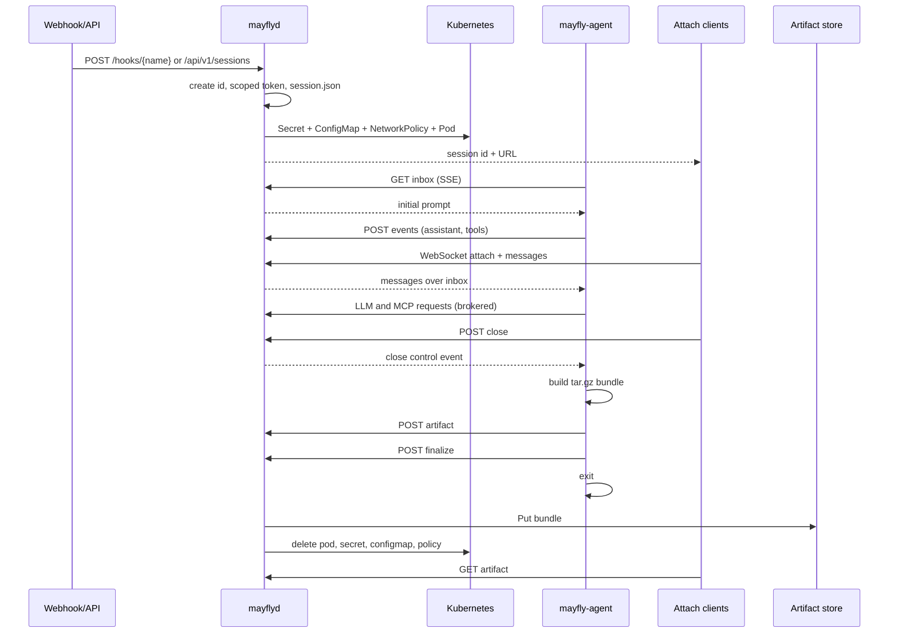

# Architecture

## Components

| Component | Responsibility |
|---|---|
| `mayflyd` | API, webhooks, session registry, thread bus, artifact storage, credential proxy, Kubernetes/local orchestration, timeouts, adoption |
| `mayfly-harness` | Image entrypoint: selects the named in-image harness or falls back to `mayfly-agent` |
| `mayfly-agent` | Built-in agent loop, MCP clients, built-in tools, conversation and trace logs, bundle assembly and upload |
| Agent manifest | Declarative agent name, prompt, model, skills, MCP servers, limits, optional runtime image |
| Web UI / CLI | Human attach over WebSocket, message send, close, artifact download |
| Kubernetes | Runs one pod per session with a per-session Secret and ConfigMap |
| Artifact store | Local filesystem or S3-compatible object storage |

The control plane and runtime communicate over HTTP. The runtime initiates every connection:

- `POST /internal/v1/sessions/{id}/events` — thread events.
- `GET /internal/v1/sessions/{id}/inbox` — server-sent stream of human messages and close requests.
- `POST /internal/v1/sessions/{id}/artifacts` — final bundle.
- `POST /internal/v1/sessions/{id}/finalize` — terminal status.
- `POST /internal/v1/llm/chat/completions` — model calls through the broker.
- `* /internal/v1/mcp/{server}` — MCP HTTP calls through the broker.

No inbound path to a session pod is required. The NetworkPolicy drops all ingress.

## Lifecycle



## State model

| Status | Meaning |
|---|---|
| `pending` | Pod created; runtime not yet running |
| `running` | Runtime connected and accepting messages |
| `closing` | Close requested; waiting for finalize |
| `completed` | Artifact exported and runtime reported success |
| `expired` | TTL elapsed before finalize |
| `failed` | Startup failure, runtime failure, delete, or fallback export |

Allowed transitions:

```text
pending -> running -> closing -> completed | expired | failed
pending -> failed
running -> failed | expired
```

`Complete` is idempotent. The manager maps a successful runtime finalize to `expired` when the close reason was TTL or expiry.

## Thread model

One in-memory stream per session holds ordered events with a monotonic sequence. Each event has a type, optional actor, text, and data.

- Humans append `user_message`.
- The runtime appends `assistant_message`, `assistant_delta`, `tool_call`, `tool_result`, `system`, `error`, and `artifact`.
- The control plane appends lifecycle `status` events and internal `control` events.

The runtime receives only `user_message` and `control` events on its inbox. This prevents the agent from re-processing its own messages.

Retention is bounded per session (`sessions.event_buffer`, default 5000 events). Session records and thread buffers live until the control plane restarts. Durable history is in the artifact bundle, not in the control plane database.

## Artifact format

`<timestamp>-<session>.tar.gz` contains:

| Entry | Content |
|---|---|
| `manifest.json` | session id, title, agent, model, status, reason, skills, MCP servers, counts, file list, partial flag, truncation flag |
| `events.jsonl` | thread events (streaming deltas excluded) |
| `conversation.jsonl` | full model-visible message history |
| `traces.jsonl` | LLM requests/responses, tool calls/results, durations |
| `files/...` | workspace files |
| `session.json` | runtime configuration for the session |

`manifest.json` is written last and lists every other entry. The upload is content-addressed by SHA-256 and verified by the control plane.

## Failure handling

| Failure | Behavior |
|---|---|
| Pod cannot start | Session becomes `failed`; error event recorded |
| Runtime exits without finalize | After a 20 s grace, the control plane exports logs and retained events as a partial bundle |
| Pod disappears | After 30 s, same fallback |
| Close does not finalize | After `sessions.close_grace` (default 90 s), force stop and fallback export |
| Artifact upload fails | Runtime retries 3 times, reports failure; control plane falls back to logs |
| Control plane restarts | Running pods labeled `mayfly.io/managed=true` are adopted from their ConfigMap and Secret; new events continue but the pre-restart thread buffer is lost |
| TTL elapses | Close with reason `expired`; runtime finalizes; status becomes `expired` |

The local backend uses a child process, a per-session state directory, and the same HTTP protocol. It provides no isolation and is for development and tests only.

## Concurrency

- One control plane process owns each session; there is no leader election. Run one replica.
- The runtime executes one agent turn at a time. Additional human messages queue.
- WebSocket clients share the session thread; every user message is broadcast to other clients and delivered to the runtime once.
- Subscribers have bounded buffers. Slow attach clients can miss live events; reconnect replays the retained backlog.
