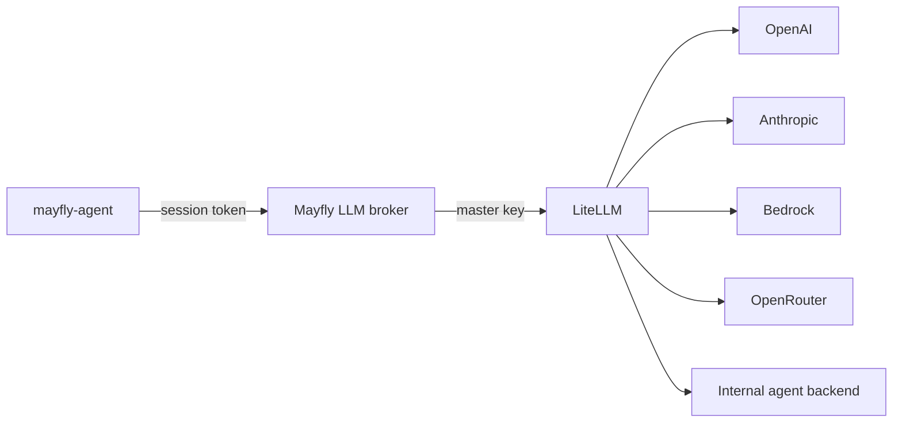

# LLM providers

Mayfly sessions call **one OpenAI-compatible broker**. The broker can point directly at OpenAI, OpenRouter, or an internal agent backend. For Claude and Bedrock, put LiteLLM in front.



Provider keys live in LiteLLM. Mayfly only holds `LITELLM_MASTER_KEY`. Sessions hold only their scoped session token.

## Mayfly config

[examples/config.litellm.yaml](../examples/config.litellm.yaml):

```yaml
llm:
  base_url: http://litellm.litellm.svc.cluster.local:4000/v1
  api_key_env: LITELLM_MASTER_KEY
  model: mayfly-default
  allow_models:
    - mayfly-default
    - claude-sonnet
    - bedrock-claude
    - openrouter-qwen
    - agent-backend
```

The model names are LiteLLM `model_name` aliases. Agent manifests select them:

```yaml
agents:
  - name: claude
    model: claude-sonnet
  - name: bedrock
    model: bedrock-claude
```

`allow_models` is the allowlist. An agent cannot select a model outside it.

## LiteLLM config

[examples/litellm/config.yaml](../examples/litellm/config.yaml):

```yaml
model_list:
  - model_name: mayfly-default
    litellm_params:
      model: openai/gpt-4.1-mini
      api_key: os.environ/OPENAI_API_KEY

  - model_name: claude-sonnet
    litellm_params:
      model: anthropic/claude-sonnet-4-5
      api_key: os.environ/ANTHROPIC_API_KEY

  - model_name: bedrock-claude
    litellm_params:
      model: bedrock/anthropic.claude-sonnet-4-5-20250929-v1:0
      aws_region_name: us-east-1

  - model_name: openrouter-qwen
    litellm_params:
      model: openrouter/qwen/qwen3-coder
      api_base: https://openrouter.ai/api/v1
      api_key: os.environ/OPENROUTER_API_KEY

  - model_name: agent-backend
    litellm_params:
      model: openai/agent-model
      api_base: https://agent-backend.internal/v1
      api_key: os.environ/AGENT_BACKEND_TOKEN

general_settings:
  master_key: os.environ/LITELLM_MASTER_KEY
```

## Auth

| Provider | Auth in LiteLLM | Auth in Mayfly |
|---|---|---|
| OpenAI | `OPENAI_API_KEY` | `LITELLM_MASTER_KEY` |
| Anthropic | `ANTHROPIC_API_KEY` | `LITELLM_MASTER_KEY` |
| Bedrock | AWS credential chain or IRSA | `LITELLM_MASTER_KEY` |
| OpenRouter | `OPENROUTER_API_KEY` and optional headers | `LITELLM_MASTER_KEY` |
| Internal agent backend | Backend token | `LITELLM_MASTER_KEY` |

LiteLLM secrets:

```bash
kubectl -n mayfly create secret generic litellm-secrets \
  --from-literal=LITELLM_MASTER_KEY="$(openssl rand -hex 24)" \
  --from-literal=OPENAI_API_KEY="sk-..." \
  --from-literal=ANTHROPIC_API_KEY="sk-ant-..." \
  --from-literal=OPENROUTER_API_KEY="sk-or-..."
```

Mayfly secret:

```bash
kubectl -n mayfly create secret generic mayfly-secrets \
  --from-literal=MAYFLY_API_TOKEN="$(openssl rand -hex 24)" \
  --from-literal=MAYFLY_WEBHOOK_SECRET="$(openssl rand -hex 24)" \
  --from-literal=LITELLM_MASTER_KEY="<same master key>"
```

For Bedrock on EKS, bind an IAM role to the LiteLLM ServiceAccount with IRSA and omit `AWS_ACCESS_KEY_ID`/`AWS_SECRET_ACCESS_KEY`. The LiteLLM pod then uses the role for `bedrock:InvokeModel` and `bedrock:InvokeModelWithResponseStream`.

## Deployment

[examples/litellm/deployment.yaml](../examples/litellm/deployment.yaml) is a starting manifest: ConfigMap, Deployment, Service. Before using it:

- Replace `ghcr.io/berriai/litellm:main-stable` with a pinned version or digest.
- Create `litellm-secrets`.
- Keep the Service private. Only the control plane needs access.
- If the image needs a writable cache, mount `/tmp` and set `HOME=/tmp`.
- Verify the readiness probe against your LiteLLM version.

Do not expose LiteLLM through the Mayfly ingress.

## Direct OpenAI or OpenRouter

Without LiteLLM:

```yaml
llm:
  base_url: https://openrouter.ai/api/v1
  api_key_env: OPENROUTER_API_KEY
  model: qwen/qwen3-coder
  headers:
    HTTP-Referer: https://mayfly.example
    X-Title: Mayfly
```

This is still one provider and one key.

## Not supported in v0.1.0

- Native Anthropic Messages API. It needs a translation adapter for tools and streaming.
- Native Bedrock Converse API and SigV4. Use LiteLLM.
- Per-agent provider keys. Provider auth is global to the control plane; agents select a model alias.
- Per-agent LiteLLM virtual keys.

Those are provider-adapter and tenancy features, not gateway configuration.
